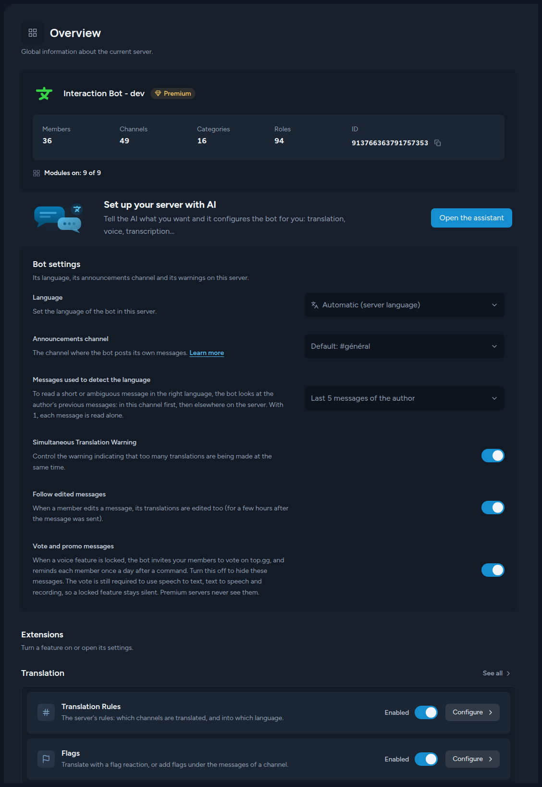

# Overview

The **Overview** page is the first item of the navigation bar. Its title is **Server Overview**. It has four parts: the server, the features of the server, the AI assistant, and the **Bot settings** card. At the bottom, **Your feedback** lets you write to the team.

<figure><figcaption>
The Overview page
</figcaption></figure>

## Server

This card shows information about your Discord server. Nothing can be changed here.

* **Members**: the number of members of the server.
* **Channels**: the number of channels of the server.
* **Categories**: the number of categories of the server.
* **Roles**: the number of roles of the server.
* **ID**: the ID of your server, with a button to copy it. You need it to find the cluster of your server on the [status page](../status.md), and for the `guild-id` option of the [Premium commands](../../premium/usage.md).
* **Premium** or **Free**: the plan of the server, shown as a badge. See [Premium](../../premium/premium.md).

## Features of the server

Below the server card, the features of the bot are listed by category: **Translation**, **Audio & AI** and **Management**. Each feature has a switch to turn it on or off for this server, and a button to open its page. A summary tells how many features are on. Turning a feature off keeps its settings. See [Dashboard](README.md#category-pages-and-extensions).

## AI assistant

The card _Set up your server with AI_ opens the AI assistant, which configures the bot from a sentence you write. See [AI assistant](README.md#ai-assistant).

## Bot settings

The **Bot settings** card has one line per setting, with its command on the right. Changes are applied when you click _Save_ (see [Save your changes](README.md#save-your-changes)).

### Bot language

The language of the messages of the bot on this server: its help, errors, panels and confirmations. **Automatic (server language)** (the default) uses the language of the server on Discord. You can also choose one of the available languages.

### Announcements channel

The channel where the bot posts the messages it sends by itself: its welcome message when it joins, the end of a Premium plan, and the messages of a recording started from the Activity. By default, it is the community updates channel of the server, else its system channel, else a private channel created by the bot when needed. The default is written under the setting.

### Messages used to detect the language

To find the language of a short or ambiguous message, the bot looks at the previous messages of the same author: in this channel first, then elsewhere on the server. This setting chooses how many messages it uses, from **1** (the message alone) to **10**. The default is **5**.

### Simultaneous translation warning

When one message is translated into more languages than the limit of your server, the bot posts a warning in the channel. The warning explains that the limit was exceeded and links to the Premium page. The switch only hides this warning: the limit itself still applies. It is on by default.

A server without Premium gets up to 3 translations of one message; a server with Premium, up to 20. See [Premium](../../premium/premium.md).

### Follow edited messages

When a member edits a message that was translated, its translations are edited too, for a few hours after the message was sent. The bot translates again at most 5 times per message and per hour. It is on by default.

### Vote and promo messages

When a voice feature is locked, the bot invites the members to vote on top.gg, and reminds each member once a day after a command. Turn this switch off to hide these messages. The vote is still required to use the voice features, so a locked feature stays silent. It is on by default.

## Your feedback

The **Your feedback** section is at the bottom of the page. It has four choices:

* **Give a review**: rate the bot from 1 to 5 stars, and write a message if you want (optional).
* **Report a problem**: tell what happened. The more precise, the better.
* **Suggest an idea**: describe what would make the bot better for you.
* **Vote on Top.gg**: opens the vote page of the bot on top.gg.

Your message can be 1000 characters long. It is anonymous unless you tick **Add my Discord name so you can reply to me**. After each message sent, a window thanks you and suggests a review on top.gg too.

The section only appears when the feedback service of the website is available.


Don't forget to click on _**Save**_ after a change in the Bot settings. The feedback is sent at once, with its own button.

