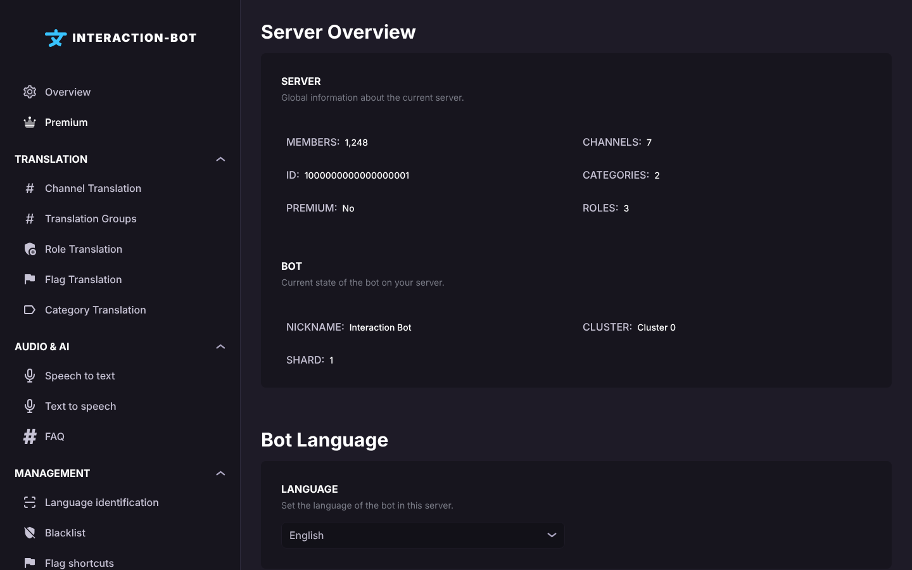

# Overview

## Localization

This page is the first item of the navigation bar. Its title is **Server Overview**.

<figure><figcaption>
Overview
</figcaption></figure>

## Server

This section shows information about your Discord server. Nothing can be changed here.

* **MEMBERS**: the number of members of the server.
* **CHANNELS**: the number of channels of the server (text, voice and the other channels; categories are not counted).
* **ID**: the ID of your server. You need it to find the shard of your server on the [status page](../status.md), and to use the `guild_id` option of the [Premium commands](../../premium/usage.md).
* **CATEGORIES**: the number of categories of the server.
* **PREMIUM**: **Yes** if the server has Premium, **No** otherwise. See [Premium](premium.md).
* **ROLES**: the number of roles of the server.

## Bot

This section shows the state of the bot on your server.

* **NICKNAME**: always shows *Interaction Bot*.
* **CLUSTER**: the cluster that runs the bot for your server, for example *Cluster 0*. A cluster runs several servers, so if a cluster has a problem, all the servers of this cluster are affected. You can check the state of all clusters on the [status page](../status.md).
* **SHARD**: the number of shards run by the cluster of your server. To know the exact shard of one server, use the *Server localization* section of the [status page](../status.md).

## Bot Language

This section sets the language of the bot messages on this server (help, errors, panels, confirmations), with the **LANGUAGE** list. **Automatic** (default) uses the language of the server on Discord; you can also choose one of the available languages. The same setting is available in Discord with [`/bot-language`](../../commands/configuration.md#language-of-the-bot).

## Warning

This section contains one toggle, **Simultaneous Translation Warning** (enabled by default).

When a single message is translated into more languages than the limit of your server, the bot posts a warning in the channel. The warning explains that the limit of your offer was exceeded, gives a link to the premium page, and tells how to disable it. The toggle only hides this warning: the limit itself still applies.

What is <em><strong>simultaneous translation</strong></em>?

When a message is posted in a channel that is translated automatically, the bot counts the translations that it makes for this message.

For example, if you post _Hello World_ in #Channel1 and the bot is configured to translate it into French, Japanese and German, the bot makes 3 translations for this message. That is the limit of a server without Premium: 3 translations per message. Premium servers can get up to 20 translations per message.

When the bot has to make more translations than the limit for one message, it shows the warning (if the toggle is enabled). To remove this warning, disable the toggle and save.

Don't forget to click on _**Save**_ after a change, see [Save your changes](README.md#save-your-changes).
