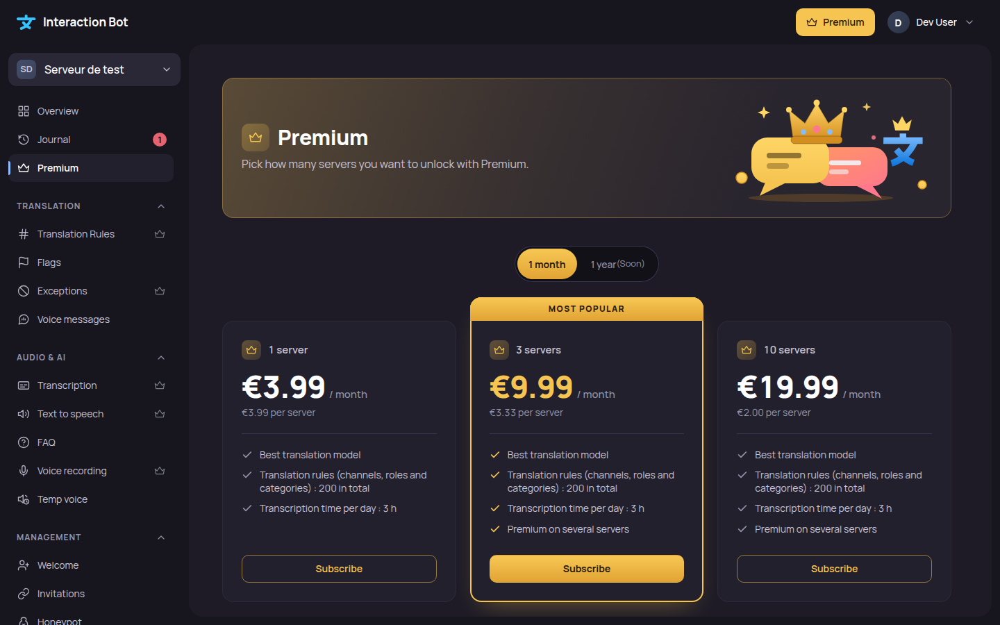

# Premium

## Localization

This page is the third item of the navigation bar, after **Overview** and **Journal**. Its title is **Premium**.

<figure><figcaption>
Premium page
</figcaption></figure>

Premium is set **per server**. Each offer (a Stripe plan or a Patreon offer) gives a number of server slots (1, 3 or 10), and each premium server uses one slot. The offers and what they bring are described in [Premium](../../premium/premium.md).

## Subscribing with Stripe

The **Subscribe** button of the offer opens the Stripe payment page, in your language. After the payment you come back to this page and a **Thank you!** pop-up waits for your subscription to be active (up to about 10 seconds), with a **Choose my servers** button.

* The plans are monthly: **1 server 3.99 EUR**, **3 servers 9.99 EUR**, **10 servers 19.99 EUR**. You have one Stripe subscription at a time: 1, 3 or 10 servers. Subscriptions bought on Patreon add to it.
* **Change plan**: in the **My subscription** block of this page (the [Account page](account.md) shows the same block and sends you here to change the plan). The difference is prorated. Going down is refused while more servers than the new plan allows have Premium: turn Premium off on the extra servers first. Not possible while a cancellation or a payment is pending.
* **Manage my subscription** opens the Stripe portal (payment method, invoices, cancellation).
* After a cancellation, Premium stays until the end of the paid period. After a failed payment, Premium is kept for a few days.
* A full refund suspends Premium and removes it from your servers; a partial refund has no effect. A dispute suspends Premium until it is won.

The yearly option is shown but not available yet.

## Offers (Patreon)

The description below is the Patreon path, still valid for existing Patreon subscriptions.

The first part of the page shows the plans: one card per offer (1, 3 or 10 servers) under **Choose a plan**.

* The selector has two options: **1 month** and **1 years** (shown as *Soon*). Only the monthly offer can be used for now: the yearly option is shown but cannot be selected.
* Each card has a **Subscribe** button, which opens the Stripe payment page. A **Subscribe through Patreon** link is shown only for a plan that Stripe does not offer, while Patreon still takes new subscriptions.

## Compare plans

At the end of the page, the **Compare plans** table shows what a free server and a premium server get. It is the same comparison as in [Premium](../../premium/premium.md).

## How to activate premium?

This section is a dropdown with the steps, and a _**Link Patreon**_ button that opens the Patreon connections page.

1. Buy an offer on Patreon (see [Subscribe](../../premium/subscribe.md)).
2. Link your Discord account to your Patreon account on the Patreon connections page. The bot reads your Discord account from your Patreon account.
3. Refresh the page, or click **Refresh my Patreon status** in the **Manage Premium** section. If you linked your account less than 10 minutes ago, wait: the bot checks Patreon every 10 minutes, so the premium is usually active after 10 minutes.

## Enable Premium on this server

Once your offer is active, go to the **Manage Premium** section, under the plans.

* **Premium** (switch): *Enable or disable your premium offers on this server.*
  * Turn it **on** to use one of your free slots for this server.
  * Turn it **off** to remove Premium from this server. The slot becomes free again and can be used on another server.

Click on _**Save**_ in the bar at the bottom of the page to apply the change.

<figure><figcaption>
Premium toggle
</figcaption></figure>

<figure><figcaption></figcaption></figure>

You can also activate Premium with the `/premium add` command, see [Usage](../../premium/usage.md).

## Errors

* **You don't have enough premiums available!** (pop-up): *Improve your premium offer or deactivate a premium on your servers.* All your slots are used, or your Discord account is not linked to an active Patreon offer. Turn Premium off on a server where you do not need it, or get a bigger offer.


Turning Premium off removes the premium features of this server right away. Premium-only options that are already saved, such as *Translate Bot*, are switched off by the next Patreon check (within about 10 minutes).


## What happens when Premium ends?

If your Patreon offer changes or ends, the premium of your servers is updated at the next Patreon check (every 10 minutes):

* If you have fewer slots than premium servers, Premium is removed from some of your servers until the number of premium servers matches your slots.
* If your Patreon membership no longer exists, Premium is removed from all your servers.

When a server loses Premium, the *Translate Bot* option is switched off in its channel and category translations.
