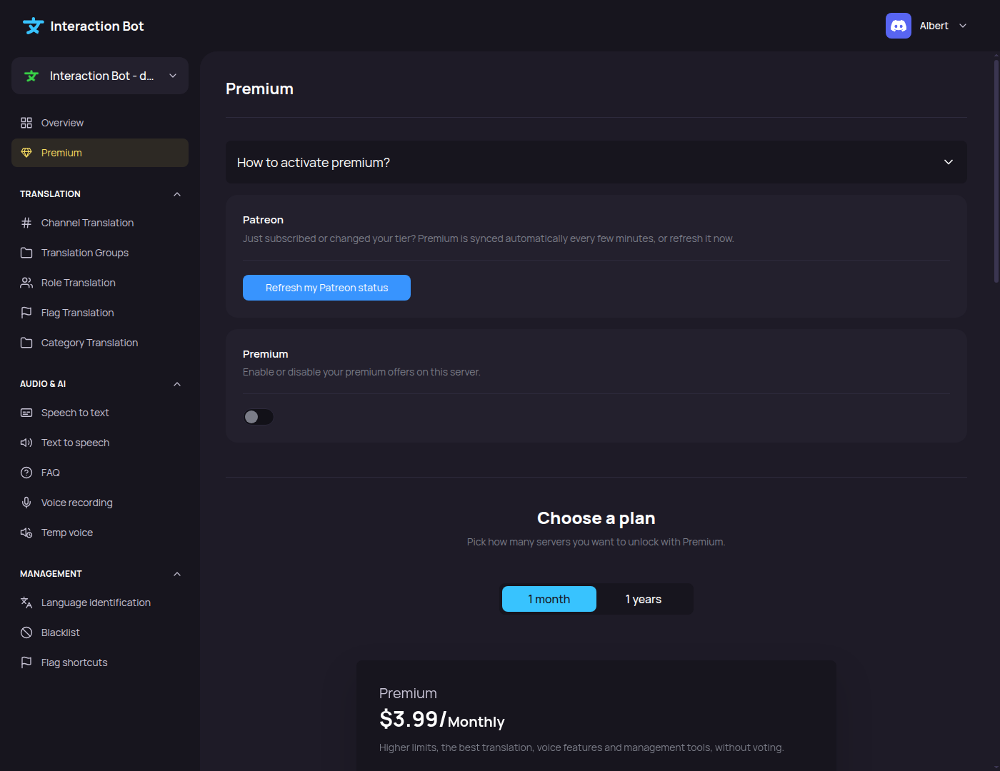

# Premium

## Localization

This page is the second item of the navigation bar, under **Overview**. Its title is **Premium**.

<figure><figcaption>
Premium page
</figcaption></figure>

Premium is set **per server**. Each Patreon offer gives a number of server slots (1, 3 or 10), and each premium server uses one slot. The offers and what they bring are described in [Premium](../../premium/premium.md).

## Offers

The first part of the page shows the offers.

* The selector at the top has two options: **1 month** and **1 years**. Only the monthly offer can be used for now: the yearly option is shown but cannot be selected.
* The **-** and **+** buttons next to the server count choose the offer: **1**, **3** or **10** servers.
* _**Subscribe Monthly**_ opens the Patreon page of the selected offer in a new tab, so you can buy it.

## Compare plans

Under the offers, the **Compare plans** table shows what a free server and a premium server get. It is the same comparison as in [Premium](../../premium/premium.md).

## How to activate premium?

This section is a dropdown with the steps, and a _**Link Patreon**_ button that opens the Patreon connections page.

1. Buy an offer on Patreon (see [Subscribe](../../premium/subscribe.md)).
2. Link your Discord account to your Patreon account on the Patreon connections page. The bot reads your Discord account from your Patreon account.
3. Open the **Premium** page of your server and click _**Refresh my Patreon status**_ (see below). Otherwise the bot checks Patreon by itself every 2 minutes, so the premium is active after 2 minutes at most.

## Refresh my Patreon status

In the **Patreon** section at the bottom of the page, the _**Refresh my Patreon status**_ button checks Patreon right now. Use it just after you bought an offer or linked your Discord account to Patreon, instead of waiting for the automatic check.

* **Patreon status updated.**: your offer was read, and your slots are up to date.
* **Already refreshed a moment ago, try again in X s.**: the check is limited to once every 30 seconds for the whole bot, to protect Patreon. Wait the indicated time, then click again.
* **Could not reach Patreon, try again later.**: Patreon did not answer. Try again in a few minutes.

If the button says your status is updated but you still have no slots, your Discord account is probably not linked to your Patreon account yet, see [Subscribe](../../premium/subscribe.md).

## Enable Premium on this server

Once your offer is active, go to the **Premium** section at the bottom of the page.

* **PREMIUM** (toggle): *Enable or disable your premium offers on this server.*
  * Turn it **on** to use one of your free slots for this server.
  * Turn it **off** to remove Premium from this server. The slot becomes free again and can be used on another server.

Click on _**Save**_ in the bar at the bottom of the page to apply the change.

<figure><figcaption>
Premium toggle
</figcaption></figure>

<figure><figcaption></figcaption></figure>

You can also activate Premium with the `/premium add` command, see [Usage](../../premium/usage.md).

## Errors

* **You don't have enough premiums available!** (pop-up): *Improve your premium offer or deactivate a premium on your servers.* All your slots are used, or your Discord account is not linked to an active Patreon offer. Turn Premium off on a server where you do not need it, or get a bigger offer.


Turning Premium off removes the premium features of this server right away. Premium-only options that are already saved, such as *Translate Bot*, are switched off by the next Patreon check (within about 2 minutes).


## What happens when Premium ends?

If your Patreon offer changes or ends, the premium of your servers is updated at the next Patreon check (every 2 minutes):

* If you have fewer slots than premium servers, Premium is removed from some of your servers until the number of premium servers matches your slots.
* If your Patreon membership no longer exists, Premium is removed from all your servers.

When a server loses Premium, the *Translate Bot* option is switched off in its channel and category translations.
