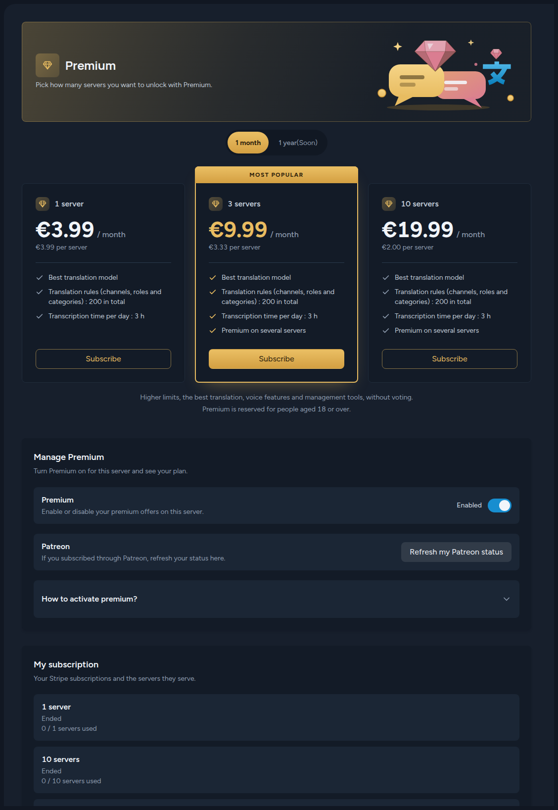

# Premium

The **Premium** page is in the first group of the menu, after **Journal**. It is the page where you buy Premium, turn it on for a server, and manage your subscription. The offers and what they bring are described in [Premium](../../premium/premium.md).

<figure><figcaption>
The Premium page of the dashboard
</figcaption></figure>

Premium is set **per server**. Each offer gives a number of server slots (1, 3 or 10), and each server with Premium uses one slot.

## The offers

The page shows the three monthly offers: **1 server €3.99**, **3 servers €9.99** and **10 servers €19.99** per month. The period selector shows **1 month** and **1 year**: the yearly offer is not available yet.

* **Subscribe** opens the Stripe payment page. After the payment, Stripe brings you back to the public Premium page of the website, where a **Thank you!** window waits for your subscription to be active (up to about 10 seconds), with a **Choose my servers** button.
* Premium is reserved for people aged **18 or over**.
* The offers are explained, with the payment and the cancellation, in [Subscribe](../../premium/subscribe.md).

## My subscription

The **My subscription** block shows your offer and the number of servers that use Premium out of the number your offer allows. It shows when the subscription renews or ends, and it has two buttons:

* **Change plan**: switches to another offer. The difference is prorated by Stripe. Going down is refused while more servers than the new offer allows have Premium: turn Premium off on the extra servers first.
* **Manage my subscription**: opens the Stripe portal, to change the payment method, see the invoices, or cancel. After a cancellation, Premium stays until the end of the paid period.

The [Account page](account.md) shows the same block, and sends you here to change the plan.

## Enable Premium on this server

Once your offer is active, the **Manage Premium** card, under the plans, has the switch for this server:

* **Premium** (switch): *Enable or disable your premium offers on this server.*
  * Turn it **on** to use one of your free slots for this server.
  * Turn it **off** to remove Premium from this server. The slot becomes free again and can be used on another server.

Click on _**Save**_ in the bar at the bottom of the page to apply the change. The same can be done with the [`/premium add`](../../premium/usage.md) and `/premium remove` commands.

Turning Premium off removes the Premium features of this server at once.

## How to activate premium

The card **How to activate premium?** explains the two ways of getting a subscription:

* **Bought on this site (card payment)**: it is activated on the Discord account you are signed in with, a few seconds after the payment. No Patreon link is needed. Refresh the page, then turn Premium on for your servers.
* **Bought on Patreon** (existing subscriptions): link your Discord account on the Patreon connections page with the **Link Patreon** button. Then click **Refresh my Patreon status** in the **Manage Premium** card. If you linked your account less than 10 minutes ago, wait: the website checks Patreon every 10 minutes.

## Messages

* **You don't have enough premiums available!**: all your slots are used, or your Discord account has no active offer. Turn Premium off on a server where you do not need it, or change your offer.
* **Premium-only options**: a Premium option that you try on a server without Premium is refused, and the page says that it requires Premium. The option is not saved.
* **Change plan** messages tell you when a change is done, when it is refused, and why.

## Compare plans

At the end of the page, the **Compare plans** table shows what a free server and a Premium server get. It is the same table as in [Premium](../../premium/premium.md).


The offer belongs to your Discord account, but Premium is turned on server by server. The dashboard only lets you change a server you can configure, so you need the **Administrator** or **Manage Server** permission on it.

