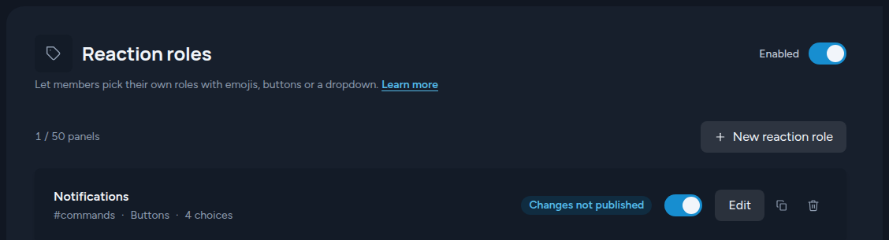
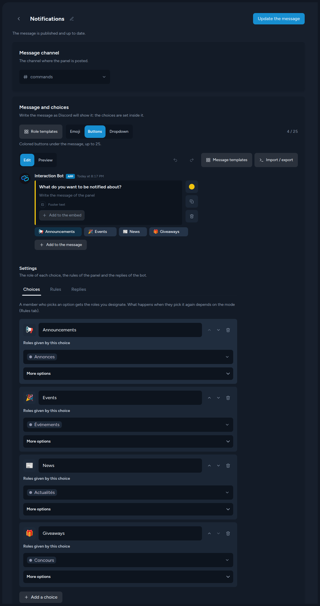
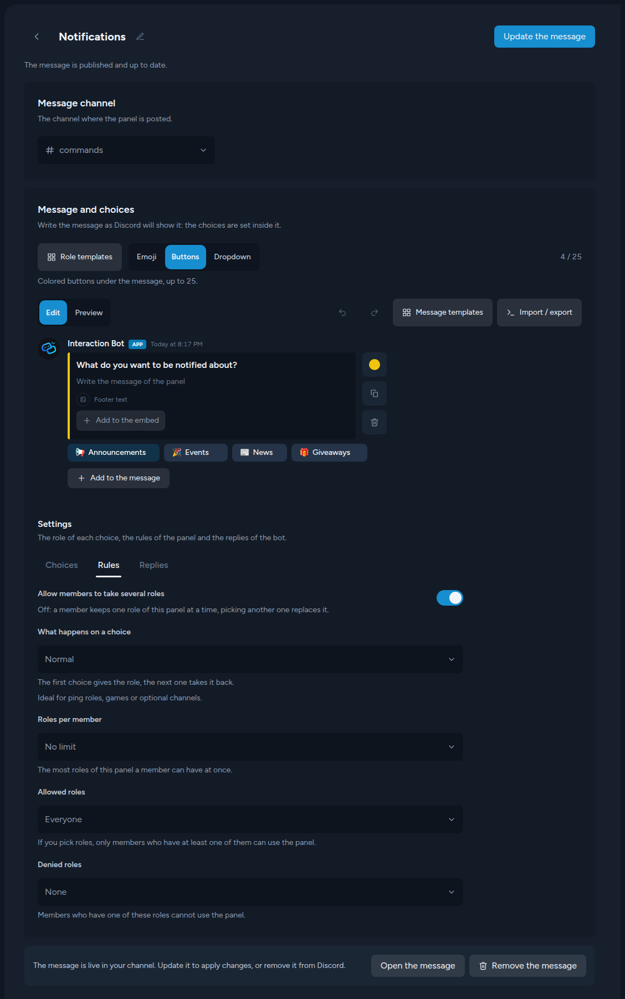

# Reaction roles

The Reaction roles page creates the panels that let members pick their own roles. How the feature works, the modes and the permissions it needs are explained in [Reaction roles](../../management/reaction-roles.md).

<figure><figcaption>
The list of reaction role panels
</figcaption></figure>

Navbar > category _**Management**_ > _**Reaction roles**_.

The switch next to the title turns the feature on or off for the server. When it is off, the panels keep their messages, but their choices give or take nothing.

## The list of panels

The page lists the panels of the server, with the quota `n / 50 panels` (drafts included).

| Element | What it does |
| --- | --- |
| _**New reaction role**_ | Creates a new draft and opens the editor. Disabled at 50 panels. |
| Row | Shows the name (or _Untitled panel_), the channel (or _No channel yet_), the type, and the number of choices. Click it to edit the panel. |
| State badge | _Draft_: never published. _Published_: the message is live and up to date. _Changes not published_: the message is live but does not have your latest changes. _Off_: the panel is switched off. |
| Switch | Turns the panel off (its message stays, its choices stop working) or on again. Applied at once. |
| _**Edit**_ | Opens the editor. |
| Duplicate | Copies the panel as a draft. |
| Delete | Asks for confirmation, then deletes the panel and its message. The members keep their roles. |

## The editor

The editor opens on a full page. The arrow at the top left goes back to the list. The name of the panel is at the top, and the button _**Publish**_ (or _**Update the message**_ once published) is next to it.

If something prevents publishing, a box _To publish this panel_ lists it above the editor. Changes are saved with the bar at the bottom of the page (_You made changes, save them!_, with _**Cancel**_ and _**Save**_). _**Publish**_ saves the changes first.

### Channel

| Field | Default | What it does |
| --- | --- | --- |
| Channel | _Pick a channel_ | The text channel where the message is posted. Dropdown of the text channels of the server. |
| Message (source) | New message | Emoji panels only: _New message_ writes a message of the bot, _Existing message_ adds the emojis to a message you already have. |
| Message ID or link | Empty | With _Existing message_: right-click the message in Discord, copy its link, and paste it here. The bot only adds its emojis to it. |

The bot checks the channel as you write: if it lacks a permission there, the page says which one.

### Message and choices

| Field | Default | What it does |
| --- | --- | --- |
| Type of choices | Buttons | _Emoji_ (up to 20 choices), _Buttons_ (up to 25) or _Dropdown_ (up to 25). The counter shows `n / limit`. |
| _**Role templates**_ | - | Fills the panel with one of the 8 ready-made templates (colors, continents, zodiac signs, platforms, RPG roles, pronouns, League of Legends, notifications). The roles that do not exist are created. See [Role templates](../../management/reaction-roles.md#role-templates). |
| Message | _Choose your roles_ and _Pick a choice below to get a role, pick it again to remove it._ | The message of the panel, written with the message builder: title, text, color, fields, pictures. The choices appear inside it: click a choice to select it, then set it in the tab _**Choice**_ on the settings card. |
| Dropdown text | _Choose your roles_ | Dropdown only: the text shown before a choice is picked. Up to 150 characters. |

The message builder is the same as for the welcome message. The variable `{SERVER}` can be used in the texts.

### Settings of the panel

The card _**Settings**_ under the message has three tabs.

#### Tab Choice

Settings of the selected choice. Each choice has:

| Field | Default | What it does |
| --- | --- | --- |
| Emoji | None | Emoji of the choice. Required for an emoji panel. Each emoji can be used by one choice only. |
| Label | Empty | Text of the choice, up to 80 characters. Required for buttons and dropdowns. |
| Description | Empty | Dropdown only. Shown under the label, up to 100 characters. |
| Roles | None | The roles given by this choice, up to 10. |
| Color of the button | Gray | Buttons only: Gray, Blue, Green or Red. |
| Duration of the role | Permanent | Permanent, 1 hour, 6 hours, 12 hours, 1 day, 3 days, 7 days, 14 days or 30 days. After this time the bot takes the role back. |

Buttons _**Move up**_, _**Move down**_ and _**Delete choice**_ are next to each choice, and _**Add a choice**_ is under the list (up to the limit of the type). The choices are shown in this order in the message.

#### Tab Rules

| Field | Default | What it does |
| --- | --- | --- |
| Allow members to take several roles | On | Off: a member keeps one role of the panel at a time. Picking another choice replaces it. |
| What happens on a choice (mode) | Normal | Normal, Add only, Remove only, Final choice, or Reversed (emoji panels only). See [Modes](../../management/reaction-roles.md#modes). |
| Roles per member | No limit | Shown when several roles are allowed: no limit, or 1, 2, 3, 4, 5, 8, 10, 15 or 25. |
| Allowed roles | Everyone | If you pick roles, only the members who have at least one of them can use the panel. Up to 25. |
| Denied roles | None | Members who have one of these roles cannot use the panel. Up to 25. |

#### Tab Replies

| Field | Default | What it does |
| --- | --- | --- |
| Answer to the member | Only visible to them (buttons and dropdowns); Private message (emojis) | Where the bot answers: _Only visible to them_ (buttons and dropdowns), _Private message_, _In the channel_ (disappears after 30 seconds) or _Nothing_. A reaction cannot be answered only to the member. |
| When a role is given | Empty (the bot's text, in the language of the server: _You now have {role}._) | A message written with the message builder. The example shown in the field is only a hint. |
| When a role is removed | Empty (the bot's text: _You no longer have {role}._) | The same, for the role taken back. |

The `{ }` button lists the variables: `{ROLE}` (the role or roles), `{USER}` (the member), `{USER_NAME}` (their name) and `{SERVER}` (the server).

<figure><figcaption>
The editor of a reaction role panel
</figcaption></figure>

<figure><figcaption>
The Rules tab of a panel
</figcaption></figure>

## Publishing and the message

| Button | What it does |
| --- | --- |
| _**Publish**_ | Saves, then writes the message in the channel. Shown while the panel is a draft. |
| _**Update the message**_ | Applies the latest saved changes to the message. Shown once published. |
| _**Open the message**_ | Opens the message in Discord. Shown once published. |
| _**Remove the message**_ | Deletes the message of the bot (or, for an existing message, removes the bot's emojis). The panel is kept as a draft. |

When a panel is published, a note says whether the message is up to date. A problem during publishing is shown above the editor, with its reason (see [Troubleshooting](../../management/reaction-roles.md#troubleshooting)).

## Limits

| Option | Limit |
| --- | --- |
| Panels per server | 50 |
| Choices (emoji / buttons or dropdown) | 20 / 25 |
| Roles per choice | 10 |
| Allowed roles / denied roles | 25 each |
| Name of a panel | 60 characters |
| Label of a choice | 80 characters |
| Description of a choice | 100 characters |
| Dropdown text | 150 characters |
| Replies | 4000 characters |

These limits apply to every server. The feature is free.
