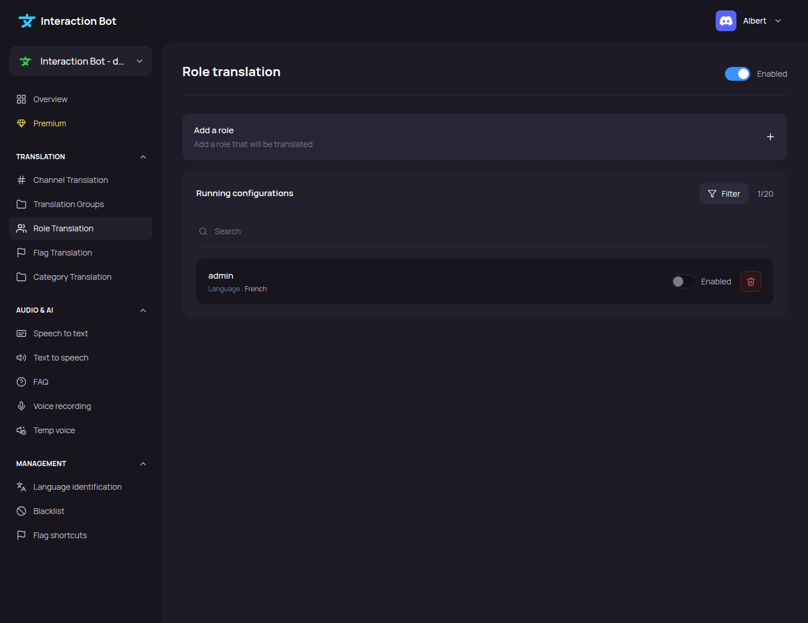
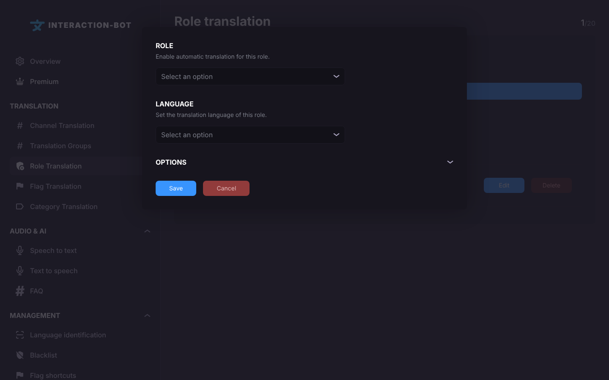
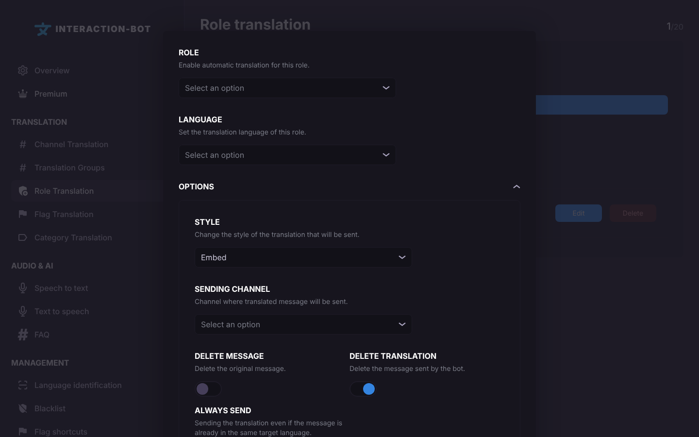

# Role Translation

## Localization

This page is the second item of the **Translation** section of the navigation bar. Its title is **Role translation**.

<figure><figcaption>
Role translation page
</figcaption></figure>

## What does role translation do?

A configuration says: *the messages posted by a member who has this **role** are translated into this **language** when they are not already in it.*

It is useful for a group of members who speak the same language, for example a *@french* role whose messages are translated into English.

* The rule applies to the messages posted in **every** channel of the server, not only one channel.
* Messages posted through a webhook are not translated by role translation.
* Members of a [blacklisted role](blacklist.md) are never translated.

## Running configurations

The list shows all the role configurations of your server.

* The counter at the top right shows how many configurations you have, for example `2/20`. On a premium server, it shows `N/~` (up to 500 configurations).
* The columns are **Role** and **Language**. Under the role name, the list shows the role ID.
* _**Edit**_: opens the configuration in the popup. Clicking on the row does the same.
* _**Delete**_: removes the configuration (applied after you click on _**Save**_).

There is no **Enabled** checkbox on this page: to stop a rule, delete it.

## Add a configuration

Click on _**Add a configuration**_ (under the box *Add a role*). On a server without Premium, when you already have 20 configurations, this button opens the Premium pop-up instead.

<figure><figcaption></figcaption></figure>

<figure><figcaption>
Role translation popup
</figcaption></figure>

The popup has two required fields:

* **ROLE**: *Enable automatic translation for this role.* Choose the role in the list.
* **LANGUAGE**: *Set the translation language of this role.* The language the messages are translated into.

Click on _**OPTIONS**_ to show the optional settings.

<figure><figcaption>
Options
</figcaption></figure>

* **STYLE**: *Change the style of the translation that will be sent.* **Embed** (default), **Webhook**, **Message** or **Thread** (the translations in a thread under the original message, with the options **LOOK IN THE THREAD**, **ARCHIVE THE THREAD AFTER** and **SHOW THE LANGUAGE**: see [Translation in threads](../../translation/threads.md)). The styles are the same as in [Channel Translation](channel-translation.md#add-a-configuration).
* **SENDING CHANNEL**: *Channel where translated message will be sent.* Optional. If it is empty, the translation is posted in the channel where the original message was posted.
* **DELETE MESSAGE** (*Delete the original message.*): the original message is deleted once its translation is sent.
* **DELETE TRANSLATION** (*Delete the message sent by the bot.*): the translation is deleted after the reading time (0.13 second per character, minimum 25 seconds). This page has no option to choose another delay.
* **ALWAYS SEND** (*Sending the translation even if the message is already in the same target language.*): sends the translation even when the message is already in the **LANGUAGE** of the configuration, or when the translation is almost identical to the original.

Click on _**Save**_ in the popup, then click on _**Save**_ in the bar at the bottom of the page.

### Example

Your server has a *@french* role. You want the messages of French members to be visible to everybody in English:

* **ROLE**: @french
* **LANGUAGE**: English
* **SENDING CHANNEL**: #english-translations (so that the translations are gathered in one channel)
* **DELETE TRANSLATION**: on

## Save configurations

When you have made all your configuration, don't forget to click on _**Save**_ in the bar at the bottom of the page.

<figure><figcaption></figcaption></figure>

## Errors

* **Error - You have not completed all the required fields.** (pop-up): no role or no language is selected.
* **It seems something has gone wrong.** (pop-up, followed by the error): the save failed. Check the number of configurations.
* The bar stays on the screen without any message when the bot refuses the save, for example because a role or a sending channel no longer exists, or because there are more than 20 configurations on a server without Premium (or more than 500 with Premium). Nothing has been saved.

## Premium

| | Free | Premium |
| --- | --- | --- |
| Configurations | 20 | 500 |

## Tips

* A member with several translated roles gets one translation per role rule, up to the limit of translations for one message (3 free, 20 Premium), see [Premium](../../premium/premium.md).
* Use **SENDING CHANNEL** to gather the translations of a role in one channel and keep the other channels clean.
