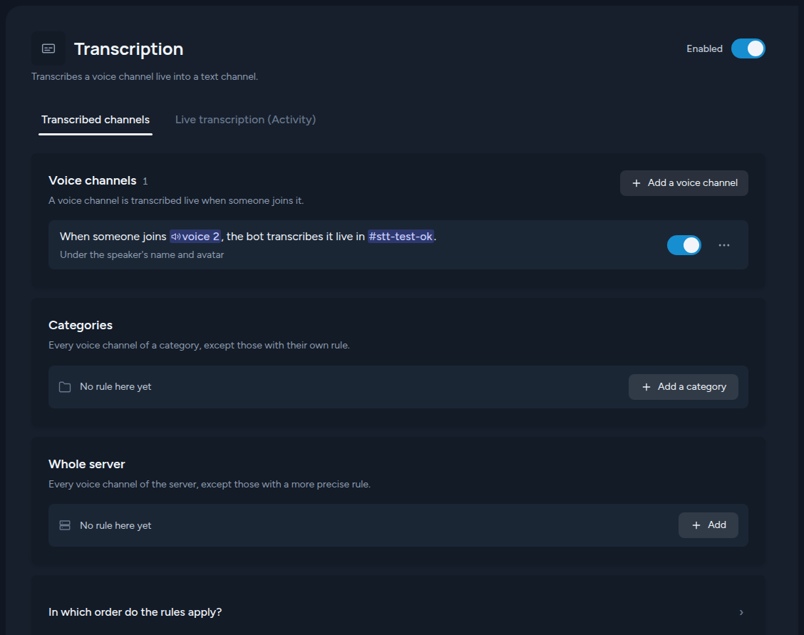
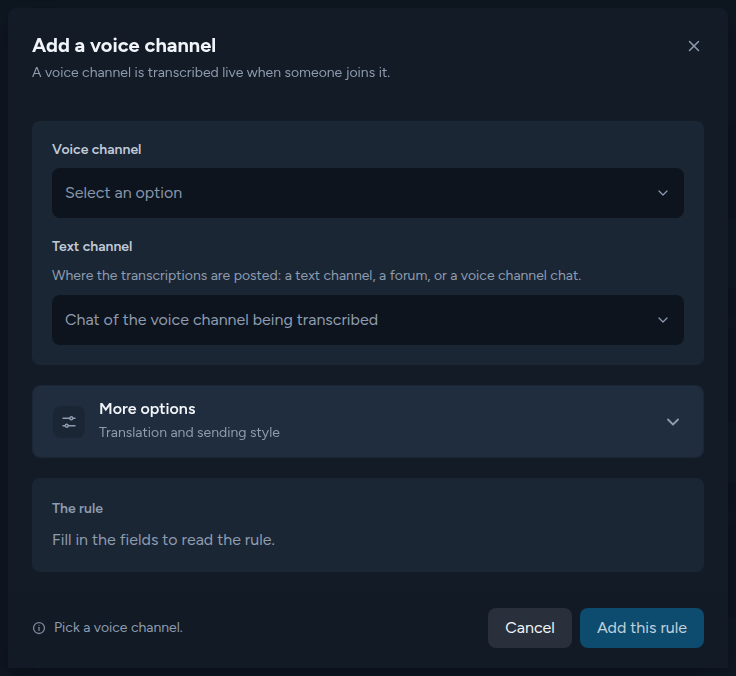

# Transcription

<figure><figcaption>
The Transcription page
</figcaption></figure>

The Transcription page sets the automatic transcription of the voice channels of your server, and the live transcription Activity of [`/transcribe live`](../../audio/live-transcription.md). The bot transcribes what is said in a voice channel and posts it in a text channel, a forum or the chat of the voice channel. The spoken language is detected automatically.

## Localization

Navbar > category _**Audio & AI**_ > _**Transcription**_.

The page has two tabs:

* **Transcribed channels**: the rules of the automatic transcription (below).
* **Live transcription (Activity)**: the settings of the Activity, see [Live transcription](#live-transcription-activity).

The switch next to the title turns the feature on or off for the whole server. When it is off, the rules are kept, but nothing is transcribed.

## Rules

A rule says **which voice channels are listened to** and **where the text is posted**. The page has three sections, one for each level, and each has its own **Add** button:

| Section | Rule | What it listens to |
| --- | --- | --- |
| **Voice channels** | Add a voice channel | One voice channel, transcribed when someone joins it. |
| **Categories** | Add a category | Every voice channel of a category, except those with their own rule. |
| **Whole server** | Add | Every voice channel of the server, except those with a more precise rule. |

The most precise rule wins: the rule of the voice channel, then the rule of its category, then the rule of the whole server. The section *In which order do the rules apply?* on the page repeats it. A paused rule is skipped: the next one applies.

Each rule opens a window with these fields:

* **Voice channel** (or **Category**): the voice channel or the category to listen to.
* **Text channel**: where the transcriptions are posted: a text channel, a forum, or the chat of the voice channel. Default: *Chat of the voice channel being transcribed*.
* **Translate to** (**premium**): translates each transcription into this language. Default: *No translation*. On a free server the field is locked and says *Reserved for premium servers.*
* **Display** (shown when a translation is set): *Translation only* (default: just the translation is posted) or *Original + translation* (the transcription, then its translation).
* **Style**:
  * **Webhook** (default): sent under the speaker's name and avatar. Needs the *Manage Webhooks* permission, otherwise a plain message is used.
  * **Message**: a plain message, speaker name followed by the text. Needs no embed permission.
  * **Embed**: a card with the speaker's name and avatar, and the transcription (or its translation). Needs *Embed Links*.

A rule can be switched **on or off** with its own switch, and removed with its menu.

<figure><figcaption>
The window of a transcription rule
</figcaption></figure>

When there are unsaved changes, the bar at the bottom of the page offers **Save** and **Cancel**. **Cancel** restores the last saved rules.

## Limits

| | Free | Premium |
| --- | --- | --- |
| Rules | 1 | 25 |
| Rules that listen to the same voice channel | 3 at most | 3 at most |
| Places a voice channel is posted to at once | 1 | 3 |
| Translation of the transcription | No | Yes |
| Daily transcription time (per server, UTC day) | 30 minutes | 3 hours |

Voice features need a premium server, or a [top.gg vote](https://top.gg/bot/893494390142697493/vote) in the last 24 hours: for an automatic transcription, from someone in the voice channel; for a command, from the person who runs it. A session stops when the daily time is used up, and the bot leaves the voice channel. The rules are explained in [Transcription](../../audio/voice.md#automatic-transcription).

## Live transcription (Activity)

The tab **Live transcription (Activity)** sets the Activity of [`/transcribe live`](../../audio/live-transcription.md). It applies to the whole server. It is saved and cancelled with the bar of the page, like the rules.

| Setting | Default | What it does |
| --- | --- | --- |
| **Live view enabled** | On | Turns the Activity on or off. When off, the Activity cannot be opened. |
| **Who can open it** | Anyone in the voice channel | *Anyone in the voice channel* or *Only members who can manage the server*. |
| **Show profile pictures** | On | Shows the picture of each speaker. |
| **Lines kept on screen** | 60 | 30, 60, 100 or 200 finished lines. |

Changes to the pictures apply at once to an open Activity. The other settings apply the next time someone opens it.

## Messages of the page

| Message | Meaning |
| --- | --- |
| *Configuration saved.* | The rules and the live settings are saved. |
| *Too many configurations for this server.* | The rules are above the limit of your plan. Free servers have one rule: get premium to add more. |
| *Too many configurations listen to the same voice channel.* | More than 3 rules use the same voice channel. Remove one of them. |
| *At most 3 configurations can listen to the same voice channel.* | The same check, shown when you add a rule. |
| *The translation of the transcription is reserved for premium servers.* | Remove the translation, or get premium. |
| *One of the output channels is not available on this server.* | The channel was deleted, or it is not a text channel, forum or voice channel chat. Choose another one. |
| *One of the voice channels is not available on this server.* | The voice channel was deleted. Choose another one. |
| *One of the categories no longer exists on this server.* | The category was deleted. Choose another one. |
| *The configuration could not be saved.* | Try again. |


The page only saves the configuration. For the permissions the bot needs and the messages posted during a session, see [Voice](../../audio/voice.md#transcription-speech-to-text) and [Voice troubleshooting](../../audio/voice-troubleshooting.md). A step by step setup is in [Voice guides](../../audio/voice-guides.md#4-transcribe-automatically-when-someone-joins).

