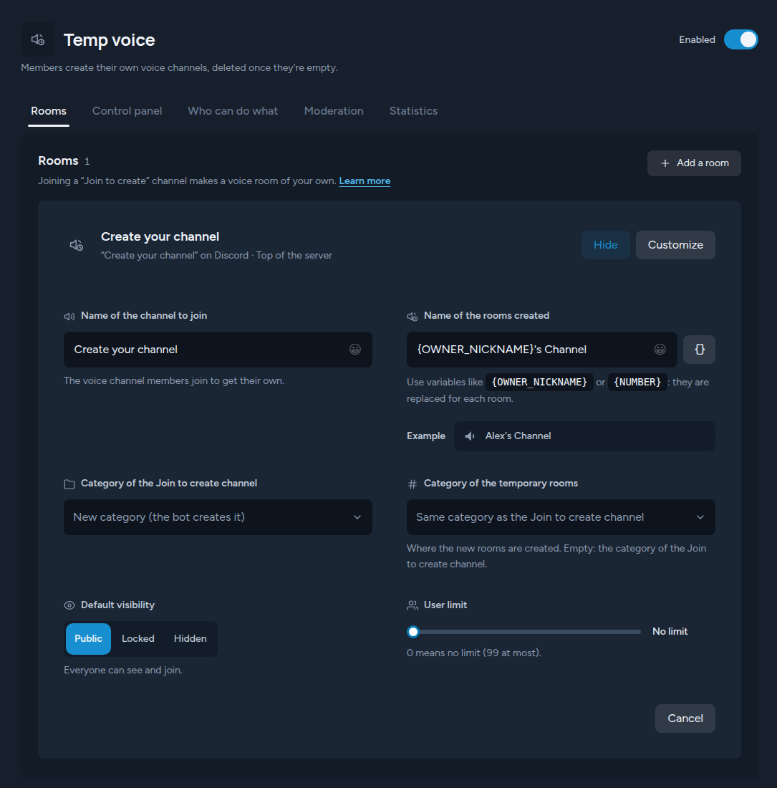
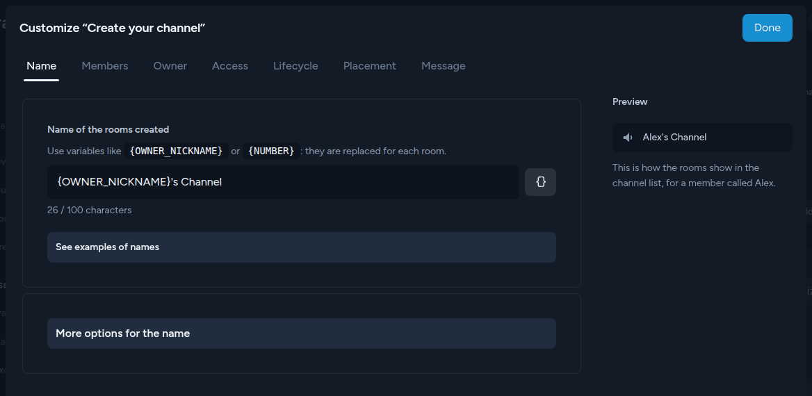
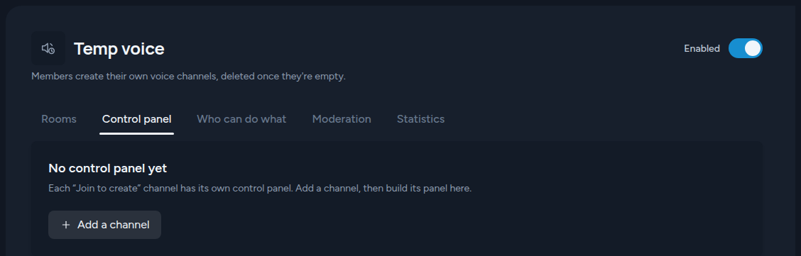

# Temp voice

<figure><figcaption>
A Join to create channel on the Rooms tab
</figcaption></figure>

Configure the temporary voice channels of the server: the **Join to create** channels, the rooms they make, and the rules of the rooms. How the feature works for members is explained in [Temporary voice channels](../../audio/tempvoice.md).

## Localization

Navbar > category _**Audio & AI**_ > _**Temp voice**_.

The switch next to the title turns the feature on or off. It stays off until a Join to create channel exists. The page has five tabs:

* **Rooms**: the Join to create channels, their settings, and the owner rules.
* **Control panel**: the message with the buttons of the room, and where it is posted.
* **Who can do what**: who can create a room, and who can use each function.
* **Moderation**: the names, the log channel and the vote kick.
* **Statistics**: the totals per day for the whole server.

Each tab has its own **Save** bar at the bottom of the page: **Cancel** restores the last saved values.

## Rooms

### Add a room

**Add a room** shows a new Join to create channel as a card, with its name, the name of its rooms, its category, its visibility and its user limit. Nothing is created before you click **Save**.

On a server with no room yet, the category of the first one is **New category (the bot creates it)**: when you save, the bot creates everything at once:

* a **TempVoice** category;
* an *interface* text channel, with the control panel;
* a **Create your channel** voice channel: the Join to create channel.

You can pick an existing category instead, or **No category (top of the server)**. If the bot is missing permissions, the page says which ones (see [Permissions needed](../../audio/tempvoice.md#permissions-needed)).

### Join to create channels

A Join to create channel is the door: each member who joins it gets a room of their own. A server can have several. Each one has these settings, which are the defaults of its rooms (the owner can change them afterwards):

| Setting | What it does |
| --- | --- |
| **Name template** | The name of the rooms, with variables such as `{OWNER_NAME}`, `{OWNER_DISPLAY_NAME}`, `{NUMBER}`, `{RANDOM}`, `{PRIVACY}`, `{CUSTOM}`, `{ACTIVITY}`, `{LANGUAGE}`. Five ready templates are offered (owner nickname, privacy and nickname, numbered, roman number and highest role, random word). |
| **User limit** | The number of places. 0 means no limit (99 at most). |
| **Bitrate** | Between 8 and 384 kbps. Empty: the bitrate of the server. |
| **Default visibility** | *Public*, *Locked* or *Hidden*. |
| **Welcome message** | The message the bot writes in a new room: none, with a mention of the owner, or silent. It can include the control panel. The text can be changed; empty means the usual message of the bot. |
| **Position** | Where the room goes compared with the Join to create channel: at the end of the category, just below it, or at the top of the category. |
| **Minimum and maximum user limit** | The owner can only choose a limit between these two. |
| **Voice role** | A role given to a member while they are in a room of this channel, then taken back. Use a dedicated role: the bot must be above it. It can go to every member in a room, or to the owner only. |
| **Rooms open at the same time** | A cap on the rooms of this channel (0 means no cap). Beyond it, a member who joins gets a message instead of a new room. |
| **Permissions of the rooms** | The role permissions copied to each room: none, those of the Join to create channel, or those of its category. *Connect*, *View* and *Send Messages* for everyone are never copied. |
| **Access mode** | For members without an access role (see [Who can create a room](#who-can-create-a-room)): *Hidden* (they do not see the rooms) or *Locked* (they see them but cannot join). |
| **Age-restricted voice chat** | Members must confirm they are adults to read the messages of the room. |
| **Owner permissions** | The Discord permissions given to the owner while they control the room (basic, moderator, full, or custom). Some of them are dangerous: the page asks for a confirmation before giving them. |
| **Language of the rooms** | Shown in the room panel, and used by the language filter of `/find`. |
| **Empty rooms** | How long an empty room is kept: deleted at once (default), or kept for a delay. |

Click **Customize** on a Join to create channel to open its editor, with the tabs **Name**, **Members**, **Owner**, **Access**, **Lifecycle**, **Placement** and **Message**. Its preview shows how the rooms look in the channel list.

<figure><figcaption>
The Customize window of a Join to create channel
</figcaption></figure>

### When the owner leaves

What happens to a room when its owner leaves while others stay in it:

* **A member claims it**: the room waits until a member takes it with the **Claim** button, or `/voice claim`.
* **It passes to a member who stayed** (default is set on the page): after 30 seconds away, the room goes to a member who stayed: a trusted member first, otherwise the one present the longest. The new owner is announced in the room.

### Profiles and access requests

* **Named profiles per member**: how many profiles a member can save (the settings of a room: name, limit, privacy). The lists of members are never saved. Off turns the profiles off.
* **Access requests**: a member can ask to join a locked room, and the owner accepts or refuses with one click, without leaving the room. You set how many requests can wait per room (up to 5, default 3) and the delay between two requests of a member.

## Who can create a room

**Who can create a room** lists the roles that may join a Join to create channel. Leave it empty to let everyone join. Up to 10 roles per function. Members without one of these roles are handled with the **Access mode** of each channel (hidden or locked).

## Who can use each function

For the owner of a room, function by function. Each function is set to **Everyone**, **Nobody**, or **Chosen roles** (up to 10 roles). Members with the *Manage Server* permission can always use them.

| Function | What it allows |
| --- | --- |
| Rename | `/voice name`, the Name button. |
| User limit | `/voice limit`, the Limit button. |
| Waiting room | `/voice waiting`, the Waiting room button. |
| Chat | Locking or unlocking the chat of the room. |
| Lock and unlock, Hide and unhide | The privacy of the room. |
| Trust and untrust | `/voice user trust`, the Trust button. |
| Block and unblock | `/voice user block`, the Block button. |
| Invite | Private invitations (`/voice user invite`). |
| Send an invite to a public chat | `/voice invite` (see the public invitations channel below). |
| Kick | The owner's instant kick. |
| Vote kick | Starting a vote to kick a member (see [Vote kick](../../audio/tempvoice.md#vote-kick)). |
| Room info | `/voice info`. |
| Region, Bitrate, Status, Password | `/voice region`, `/voice bitrate`, `/voice status`, `/voice password`. |
| Thread | The chat thread of the room. |
| Claim ownership, Transfer ownership | `/voice claim`, `/voice transfer`. |
| Delete | `/voice delete`. |
| Reset settings | `/voice reset`. |
| Access requests | Who may ask to join a locked room. |

A function given to *Nobody* is refused for everyone but the members with *Manage Server*: the command answers *This function is disabled on this server.* A function reserved to roles answers *This function is reserved to: ...*.

## Control panel

<figure><figcaption>
The Control panel tab
</figcaption></figure>

The control panel is the message with the buttons of a room. It is posted:

* in the chat of a room, by the owner with `/tempvoice panel`, or when the room is created if the welcome message includes it;
* in any text channel of the server, with **Post the panel** on the page: the buttons act on the temporary room the member is connected to. You can post it several times.

The page shows a preview of the panel. The buttons of the panel are the ones of [the control panel](../../audio/tempvoice.md#control-panel): name, limit, privacy, waiting room, trust, untrust, block, unblock, invite, kick, region, claim, transfer and delete, and the **More options** menu (status, password, bitrate, public invitation, purge, reset, room info).

## Moderation and log

* **Name moderation**: automatically hides insults, links and mass mentions in the names and statuses of the rooms.
* **Censored words**: words hidden in the names and the status. A `*` is a wildcard: `word*` covers every word that starts with it, `*word` every word that ends with it, `*word*` every word that contains it. Each word has 32 characters at most.
* **Log channel**: creations, deletions, renamings, kicks, blocks and changes of owner are written there. Empty: no log.
* **Vote kick**: the share of the members of a room who must vote to kick someone out, from 10 % to 100 % by steps of 5 (default 50 %). With the Vote kick function off, nobody can start a vote.
* **Public invitations channel**: the text channel where the owner's `/voice invite` posts its message and link. It must be a public channel.

## Statistics

The **Statistics** tab shows the totals per day for the whole server, for the period you choose. Nothing is recorded about any member. The same totals are available with `/tempvoice stats`.

## Messages of the page

| Message | Meaning |
| --- | --- |
| *Settings saved.* / *Channel settings saved.* | The settings are saved. |
| *The settings could not be saved.* | Try again. |
| *Create a Join to create channel before turning temporary voice channels on.* | The feature needs at least one Join to create channel. |
| *Fallback categories are a Premium feature. Remove them to save.* | The fallback categories are for Premium servers only. |
| *One of the roles does not exist anymore. Remove it and save again.* | A role was deleted. |
| *The bot cannot give this role: it is above its own role.* | The role of a voice role or of a function is above the bot's role. Move the bot's role above it. |
| *The bot does not answer. Try again in a few seconds.* | The bot is not reachable. |
| *The room name is empty, too long, or uses an unknown placeholder.* | Fix the name template. |
| *The bitrate must be between 8 and 384 kbps, or empty.* | Fix the bitrate. |
| *The user limit must be a whole number between 0 and 99.* | Fix the limit. |
| *The vote share must be a multiple of 5, between 10 and 100.* | Fix the share. |
| *Confirm the risk before giving the owner a dangerous permission.* | Tick the confirmation under the owner permissions. |
| *The bot cannot write in this channel. Give it the View Channel, Send Messages and Embed Links permissions.* | The panel cannot be posted there. |

## Limits

| | Free | Premium |
| --- | --- | --- |
| Rooms | Yes, as many as Discord allows (500 channels per server) | Yes |
| Fallback categories (used when the category is full, 50 channels) | No | Yes |
| Temporary voice role, moderation, statistics | Yes | Yes |

The room features are free for every server. The fallback categories are the only Premium option of the feature. See [Premium](../../premium/premium.md).
