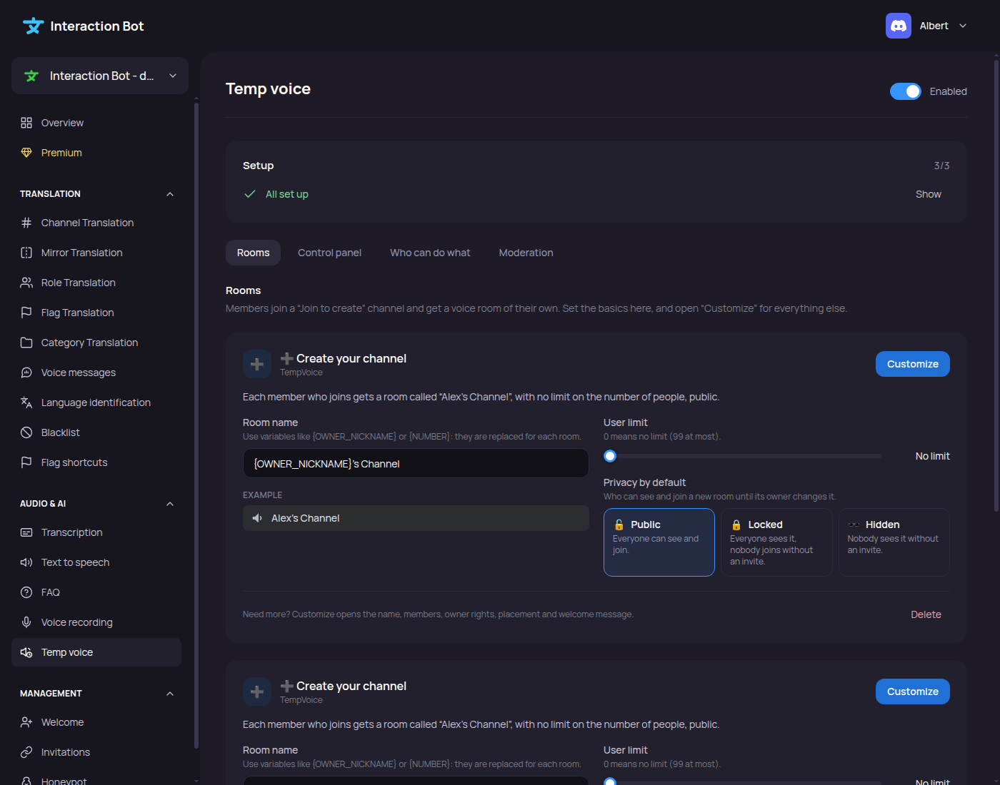

# Temp voice

<figure><figcaption>
Temp voice page
</figcaption></figure>

Configure the temporary voice channels of the server: the **Join to create** channels, the rooms they make, and the rules of the rooms. How the feature works for members is explained in [Temporary voice channels](../../audio/tempvoice.md).

Navbar > category _**Audio & AI**_ > _**Temp voice**_.

The page has four tabs: _**Rooms**_, _**Control panel**_, _**Who can do what**_ and _**Moderation**_.

## Turn it on and set it up

The switch next to the title turns temporary voice channels on or off for the whole server. It needs a **Join to create channel** first: without one, the switch says _Create a Join to create channel below first._

Turning the feature off stops the creation of new rooms. The rooms already open are not deleted.

When the server has no Join to create channel yet, the page shows the **Quick setup** card:

* _**Set up automatically**_ prepares the installation: a category called `TempVoice`, a text channel `interface` with the control panel, and a voice channel `Create your channel` to join. The feature is turned on. Nothing is created on Discord until you click _**Save**_.
* _**Use an existing category instead**_ opens a manual setup: choose the category of the Join to create channel (default: _No category (top of the server)_), then click _**Create the Join to create channel**_. The channel is created when you save.

Once a Join to create channel exists, the **Setup** card lists three steps, with a ✓ when each one is done:

1. A Join to create channel exists.
2. The control panel is posted in a channel (the button _**Post the panel**_ opens the _Control panel_ tab).
3. Temporary voice channels are on.

When the three steps are done, the card folds into one line, _All set up_, that you can open again.

The `/tempvoice setup` command does the same thing, and also creates a control panel channel. See [Temporary voice channels](../../audio/tempvoice.md#set-up-in-2-minutes).

## Rooms tab

Each Join to create channel has its own card. A member who joins it gets a room, and the settings of the card are the defaults of that room. The owner can then change them with the [commands](../../audio/tempvoice.md#commands) and the [control panel](../../audio/tempvoice.md#control-panel).

Each card shows:

* the **name** of the channel and its category (or _Top of the server_), with a _Modified_ badge when it has unsaved changes;
* a sentence that sums up the default room, for example _Each member who joins gets a room called "Alex's Channel", 5 places, public._;
* the **room name** with a live example underneath;
* the **user limit** (slider, 0 to 99; 0 means no limit);
* the **privacy by default**: _Public_ (everyone can see and join), _Locked_ (everyone sees it, nobody joins without an invite) or _Hidden_ (nobody sees it without an invite).

Click _**Customize**_ to open the editor of the card. It has five tabs: _Name_, _Members_, _Owner_, _Placement_ and _Message_, and a preview of the room in the channel list. _**Done**_ closes the editor (the Escape key does too). The changes are saved with the bar at the bottom of the page.

### Name tab

* **Room name**: the template of the name, 100 characters at most. A warning lists the variables the server does not know.
* **Templates**: five examples to start from: _Owner nickname_ (`{OWNER_NICKNAME}'s Channel`), _Privacy and nickname_ (`{PRIVACY} {OWNER_NICKNAME}`), _Numbered_ (`Voice {NUMBER}`), _Roman number and highest role_ (`{NUMBER_ROMAN} - {ROLE_HIGHEST}`) and _Random word_ (`{RANDOM} lounge`).
* **Insert a variable**: click a variable to insert it at the cursor. They are listed in [Placeholders](#placeholders).
* **Icons and words used by the variables**: the three privacy icons, the default text of `{CUSTOM}`, the text used when the owner has no role, and the words of `{RANDOM}`.
* **Censored words**: words hidden in the names, the statuses and the invitations of the creator's rooms. Type a word, then press Enter. A word has no spaces and 32 characters at most, and the list keeps 100 words at most. A `*` is a wildcard: `word*` covers every word that starts with it, `*word` every word that ends with it, `*word*` every word that contains it.
* **Waiting room name**: the name of the waiting room. Same variables as the room name, except `{CUSTOM}` and `{PRIVACY}`. Empty: the default text of the bot.

### Members tab

* **User limit**, and the **minimum** and **maximum** user limit: the range the owner can choose in the room. 0 (no limit) is only allowed when the minimum is 0.
* **Privacy by default**: the same three choices as on the card.
* **Members without an access role**: shown only when access roles are chosen in _Who can do what_. _Hidden_: they do not see the rooms. _Locked_: they see them but cannot join.
* **Age-restricted voice chat** (off by default): marks the rooms as age-restricted. Members must confirm they are adults to read the messages.
* **Temporary voice role**: a role given while a member is in a room of this creator, then taken back. _Who gets it_ is _Every member in a room_ (default) or _The owner only_. Use a dedicated role: the bot must be above it.

### Owner tab

* **Rooms managed by their owner** (on by default): when off, there is no owner: nobody can customise or moderate the rooms, there is no control panel and no command. Empty rooms are deleted.
* **Permissions of the owner**: _Basic_ (the owner renames, limits and locks the room, nothing more), _Moderator_ (also moves, mutes and deafens members in the room), _Full_ (also manages the channel, messages, threads and invitations) or _Custom_, where you pick each permission. The default is Manage Channels and Move Members.

  
  _Manage Permissions_ lets the owner change every permission of the room, including the ones of this module. _Move Members_ also lets the owner move, and so kick from the room, the moderators of the server. The page asks you to confirm the risk before saving one of these two permissions.
  

* **Permissions of the rooms**: the role permissions copied to each new room: _None_ (default), _Those of the Join to create channel_, or _Those of its category_. Connect, View and Send Messages for everyone are never copied.

#### Restore the owner's settings

When an owner creates a new room, the settings the owner had in their previous room come back, depending on the switches of this card: the name, the user limit, the trusted and blocked lists, and the privacy (locked, hidden). The bitrate and the region are not remembered.

### Placement tab

* **Category of the temporary rooms**: where the new rooms are created. Default: _Same category as the Join to create channel_.
* **Position of the room**: _End of the category_ (default), _Just below the Join to create channel_ or _Top of the category_. Discord can move a room a little when many rooms are created at once.
* **Fallback categories** (**Premium**): used when the category above is full (50 channels). Up to 10 categories.
* **Bitrate**: _Server default_ (default), _Highest possible_ (the highest value the boost level of the server allows), or a value from 8 to 384 kbps.
* **Public invitations channel**: the public text channel where the `/voice invite` command posts its message and link. It must be a public channel. Default: _No channel_.

### Message tab

The message is written in the chat of each new room.

* **Sending**: _No message_, _With a mention_ (mentions the owner, who gets a notification) or _Silent_ (writes the message without notifying anyone). Default: _Silent_.
* **Message text**: 1900 characters at most. Empty: only the control panel is sent, if it is ticked. Click a placeholder to insert it at the cursor. The message also accepts `{OWNER_MENTION}`, `{OWNER_ID}`, `{GUILD_ID}` and `{CHANNEL_ID}`.
* **Include the control panel** (on by default): adds the buttons to rename, lock or invite right in the message.

The preview under the message shows how it looks in Discord, with an example owner.

## Adding and deleting a Join to create channel

Under the cards, the section _**Add a Join to create channel**_ shows the category of the new channel: the category of the first Join to create channel, or the top of the server. Click _**Choose another category**_ to pick another one. Click _**Add a Join to create channel**_ to prepare it: it appears in the bar at the bottom of the page, with an _Undo_ button.

_**Delete**_ on a card prepares the deletion, with an _Undo_ button. The rooms already open are not deleted.

Nothing is created or deleted on Discord until you click _**Save**_ in the bar at the bottom of the page.

## Who can create a room

On the _Who can do what_ tab, under _**Who can create a room**_, choose the roles allowed to join a Join to create channel. Leave it empty to let everyone create a room.

A member without one of these roles gets a private message saying that they need one of the roles the server allows, and no room is created.

## Who can use each function

On the _Who can do what_ tab, each function of a room has one of three rules, chosen with the buttons _Everyone_, _Chosen roles_ or _Nobody_:

| Rule | Meaning |
| --- | --- |
| Everyone | Default. Any owner can use the function. |
| Chosen roles | Only the members with one of the chosen roles. Up to 10 roles per function. |
| Nobody | No owner can use the function. |

Members with **Manage Server** can always use every function.

The functions are grouped in five families:

| Family | Functions |
| --- | --- |
| Customize the room | Rename, User limit, Bitrate, Region, Status, Thread, Room info |
| Privacy and access | Lock and unlock, Hide and unhide, Password, Waiting room, Chat, Chat of the room |
| People | Trust and untrust, Block and unblock, Invite, Send an invite to a public chat, Kick, Vote kick |
| Ownership | Claim ownership, Transfer ownership |
| Upkeep | Delete, Reset settings |

Two presets set all the rules at once: _**Everyone can do everything**_ and _**Essentials only**_. Essentials keeps Rename, User limit, Status, Room info, Lock and unlock, Hide and unhide, Waiting room, Chat, Chat of the room, Trust and untrust, Block and unblock, Invite, Send an invite to a public chat and Kick on _Everyone_, and sets the other functions to _Nobody_.

The commands and buttons each function controls are listed in [Commands](../../audio/tempvoice.md#commands) and [Control panel](../../audio/tempvoice.md#control-panel). When a member is refused a function, the bot says whether the function is disabled for everyone, or which roles may use it.


_Chat of the room_ controls who can write in the chat of the voice channel. With _Nobody_ or chosen roles, @everyone is refused in the chat; with chosen roles, those roles can write.


## Control panel

On the _**Control panel**_ tab, choose a **text channel**. The page shows the channel where the panel is posted now, if any. The panel is posted when you click _**Save**_: choosing another channel and saving posts it there.

The bot needs the View Channel, Send Messages and Embed Links permissions in that channel.

The preview shows the buttons the members will have. The buttons turned off in _Who can do what_ are crossed out, and a line gives the number of buttons available.

## Moderation

On the _**Moderation**_ tab:

* **Name moderation** (on by default): automatically hides insults, links and mass mentions in the names and statuses of the rooms. Links and mentions are always neutralised, even when it is off. The censored words still apply when name moderation is off.
* **Log channel**: the text channel where the events of the temporary rooms are written: creations, deletions, renamings, limits, privacy changes, kicks and blocks, votes, changes of owner. Default: _No log channel_.
* **Vote kick**: the **share of votes** needed to remove a member, **50 %** by default. The share goes from **10 %** to **100 %**, by steps of **5 %**. The number of yes votes needed is the share of the members who can vote, rounded up (at least one). See [Vote kick](../../audio/tempvoice.md#vote-kick) for the rules.

## Placeholders

The room name, the waiting room name and the welcome message use placeholders written between braces. Click a placeholder to insert it at the cursor.

| Placeholder | Value |
| --- | --- |
| `{OWNER_NAME}` | The name of the owner. |
| `{OWNER_DISPLAY_NAME}` | The display name of the owner. |
| `{OWNER_USERNAME}` | The username of the owner. |
| `{OWNER_NICKNAME}` | The nickname of the owner on this server. |
| `{OWNER_CREATED}` | The date the owner account was created (day/month/year). |
| `{OWNER_JOINED}` | The date the owner joined this server (day/month/year). |
| `{NUMBER}` | The smallest free number: 1, 2, 3... |
| `{NUMBER_ROMAN}` | The number in Roman numerals: I, II, III... |
| `{NUMBER_ALPHA}` | The number in letters: A, B... Z, AA... |
| `{NUMBER_DIGIT}` | The number with three digits: 001, 002... |
| `{NUMBER_EXPONENT}` | The number in superscript: ¹, ², ³... |
| `{RANDOM}` | A random word from the list of _Words for RANDOM_, or a fallback icon. |
| `{PRIVACY}` | The privacy icon: locked, unlocked or hidden. |
| `{CUSTOM}` | The name the owner chose with `/voice name`. |
| `{ACTIVITY}` | The activity of the members, or a fallback. |
| `{ACTIVITY_NAME}` | The name of the activity. |
| `{ROLE_HIGHEST}` | The highest role of the owner. |
| `{ROLE_HOIST}` | The highest role of the owner, shown apart in the member list. |

## Saving

Everything on the page is prepared, then applied when you click _**Save**_ in the bar _**You made changes, save them!**_ at the bottom of the page. _**Cancel**_ removes the unsaved changes and goes back to the last saved configuration.

On _Save_, the page does the following, in this order:

1. the quick setup, if it was chosen;
2. the control panel, if its channel changed;
3. the deletions of Join to create channels;
4. the creations of Join to create channels;
5. the settings of the page and the changes of each card.

If one step is refused, the page shows the message and keeps what was not done.

## Limits

* Every setting of this page is free, except **fallback categories** (**Premium**).
* Temporary voice channels need no vote on top.gg.
* Discord limits a server to 500 channels, and a category to 50 channels: a full category is replaced by a new one. The full list of limits is in [Limits](../../audio/tempvoice.md#limits).

## Messages of the page

| Message | Meaning |
| --- | --- |
| _Create a Join to create channel before turning temporary voice channels on._ | The switch needs a Join to create channel. |
| _The bot cannot give this role: it is above its own role._ | Move the bot role above the role, in the server settings. |
| _One of the roles does not exist anymore. Remove it and save again._ | A role was deleted. Remove it from the list. |
| _This category does not exist anymore._ | The category was deleted. Choose another one. |
| _This channel is not a Join to create channel anymore. Reload the page._ | The channel was deleted. Reload the page. |
| _The room name is empty, too long, or uses an unknown placeholder._ | Fix the name, or use only the placeholders of the list above. |
| _The user limit must be a whole number between 0 and 99._ | Enter a valid number. |
| _The bitrate must be between 8 and 384 kbps, or empty._ | Enter a valid value. |
| _The limit range is invalid: the minimum must be at most the maximum, and the default limit must be inside it._ | Fix the minimum, the maximum or the default limit. |
| _The vote share must be a multiple of 5, between 10 and 100._ | Choose a value in the list. |
| _A function can be given to 10 roles at most._ | Remove roles from this function. |
| _Fallback categories are a Premium feature. Remove them to save._ | Remove the fallback categories, or get premium. |
| _The welcome message is too long (1900 characters at most) or uses an unknown placeholder._ | Shorten the message, or fix the placeholder. |
| _The public invitations channel must be a public text channel._ | Choose a public text channel, or _No channel_. |
| _The waiting room name uses an unknown variable or is too long._ | Fix the name. |
| _Confirm the risk before giving the owner a dangerous permission._ | Tick the confirmation under the owner permissions. |
| _The bot cannot write in this channel. Give it the View Channel, Send Messages and Embed Links permissions._ | Give the permissions in that channel. |
| _The settings could not be saved._ | Try again. |


The page only saves the configuration. The permissions the bot needs are listed in [Permissions needed](../../audio/tempvoice.md#permissions-needed), and the commands of the members are in [Commands](../../audio/tempvoice.md#commands).

