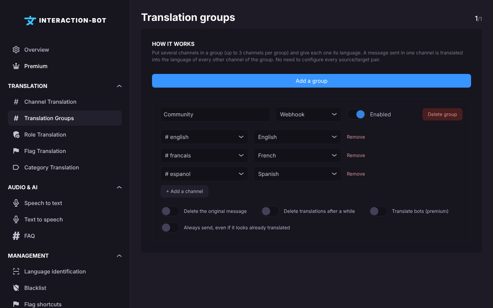

# Translation Groups

<figure><figcaption>
Translation groups page
</figcaption></figure>

## Localization

Navbar > category _**Translation**_ > _**Translation Groups**_.

## How it works

Put several channels in a group and give each one its language. A message sent in one channel is translated into the language of **every other channel** of the group. No need to configure every source/target pair. The same groups can be managed with the [`/group` commands](../../commands/groups.md).

## Create a group

Click on _**Add a group**_ (the counter at the top right shows how many groups you use). For each group:

* **Group name** (up to 40 characters, unique).
* **Style**: Embed, Webhook (default) or Message.
* **Enabled**: pause the whole group without deleting it.
* **Channels**: click _**+ Add a channel**_, choose the channel and its language. A channel can only appear once in a group.
* **Delete the original message**: keep only the translations.
* **Delete translations after a while**: the translations are deleted after _**Keep for (seconds)**_ (from 5 to 86400, empty = automatic, depends on the length of the text).
* **Translate bots** (**premium**): also translate messages sent by bots.
* **Always send, even if it looks already translated**.

A _**Delete group**_ button removes the group. Don't forget to save the changes in the popup that appears at the bottom.

## Limits

| Free                        | Premium                      |
| --------------------------- | ---------------------------- |
| 1 group of up to 3 channels | 5 groups of up to 5 channels |
