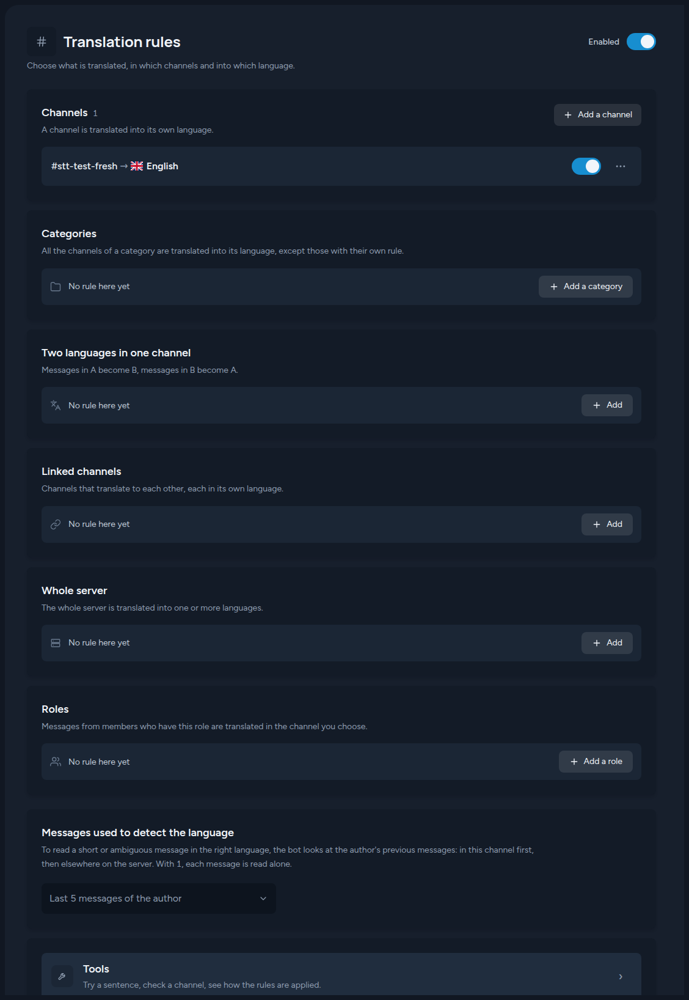

# Translation rules

The **Translation rules** page is the first page of the **Translation** section of the dashboard. It holds every automatic translation of the server on one page: channels, two languages in one channel, linked channels, categories, roles and the whole server. It replaces the former Channel, Role, Category and Link pages.

<figure><figcaption>
The Translation Rules page
</figcaption></figure>

## Where to find it

**Translation** > **Translation rules** in the sidebar. The other pages of the section are **Flags**, **Exceptions** and **Voice messages**.

The first time you open the page, the former configurations of your server are converted to rules automatically. A short notice tells you when it is done. Nothing is lost.

## What the page shows

* One **section** per type of rule. Each rule is written as a sentence, for example *Messages in #announcements are translated into French, in #annonces*.
* A rule that is paused is shown as **Paused**. The switch of its row turns it on or off.
* The **⋯** menu of a rule: **Edit**, **Copy** (to other channels; not for linked channels) and **Delete**.
* A line under a rule states its problems (a paused rule, a missing permission). When a rule has no problem, a **Why isn't it translating?** link opens the **Check a channel** tool for its channel.
* A banner at the top counts the paused rules and the rules that lack a permission, with a **See** button that goes to the first one.
* A notice at the top appears when a message could need more translations than the limit of its offer (see [Limits](#limits)).


A message is translated by **the most precise rule** of its channel: two languages in one channel, then the channel, then its category, then the whole server. Roles and linked channels are described in [Automatic translation](../../translation/automatic.md#which-rule-applies).


## Add a rule

Click **Add a rule**, or the **Add** button of a section, and choose the type of rule:

| Type                             | What it does                                                                                                       |
| -------------------------------- | ------------------------------------------------------------------------------------------------------------------ |
| **Whole server**                 | The whole server is translated into one or more languages.                                                         |
| **Channels**                     | A channel is translated into its own language(s).                                                                  |
| **Two languages in one channel** | Messages in language A become B, and messages in B become A. What happens to a message in neither language can be chosen. |
| **Linked channels**              | Channels that translate into each other, each in its own language.                                                 |
| **Categories**                   | All the channels of a category are translated, except those that have their own rule.                              |
| **Roles**                        | Messages of the members who have a role are translated, in the channel you choose.                                 |

A channel can have only one channel rule: if it already has one, the page offers to **Replace** it.

The popup asks first for what the rule applies to (the channel, the category, the role, or the languages), then for the languages. Then you can open **More options**.

## Options of a rule

The popup holds the options you change often. **More options** holds three groups:

* **Sending**: the **channel** where the translations are sent (*The same channel* by default); the **style**: *As the author* (name and avatar of the author), *Bot message*, or *Bot card* (an embed).
* **Deletion**: **Delete the translation after**: *Never*, *Automatic (reading time)*, or *After N seconds* (from 5 seconds to 24 hours); and **Delete the original message** (needs the *Manage Messages* permission).
* **Advanced**: **In a thread under the original message** (channel rules only, the original message is kept), with its look, archive delay and language label; **Translate bots** (Premium); **Send even if the text seems already translated**; and, for linked channels, **Translate in the original channel too**.

Each option is explained in [Styles and options](../../translation/styles-and-options.md).


**Translate bots** needs Premium: on a free server, a click on its switch opens the Premium window instead.


## Copy, pause, edit, delete

* **Copy** opens the popup of the rule, filled in, to create the same rule for other channels. A channel rule can be copied to several channels at once.
* **Pause** (the switch of the row) keeps a rule without applying it.
* **Edit** opens the popup of the rule.
* **Delete** asks for a confirmation (*Delete the rule “…”?*). The deleted rule stays struck through until you save: **Restore** brings it back.

## Save

Changes are kept on the page until you click **Save** in the bar at the bottom, which reads *You made changes, save them!*. **Cancel** drops them. You cannot leave the page with unsaved changes without being warned.

If saving fails, the page shows *Saving failed. Your changes are still here: try again.* If your session has expired, the page asks you to sign in again to save.

## Limits

| Limit                                                 | Free  | Premium |
| ----------------------------------------------------- | ----- | ------- |
| Rules per server                                      | 30    | 200     |
| Languages in one rule (in the form)                   | 5     | 20      |
| Translations of one message (sent by the bot)         | 3     | 20      |
| Linked channels: links per server, channels per link  | 1, with 3 channels | 5, with 5 channels |

A message is translated into **3 languages at most** on a free server. When a rule would go over this, the notice at the top of the page lists the affected channels, with a **See Premium** button on a free server. The translations beyond the limit are not sent.

## Tools

The **Tools** section, closed by default, has three tools.

### Try a sentence

Choose a channel, type a sentence (300 characters at most), and press **Try**. The tool shows the language detected, which rules would translate the sentence in this channel, into which languages, and where each translation would be sent. It also shows which translations the per-message limit cuts. Without a sentence, the tool lists the rules that apply to the channel. The test uses the **saved** rules: save your changes first.

### Check a channel

Choose a channel, then press **Check**. *Why isn't this channel translated?* The tool lists, one by one, what works and what blocks the translation:

* a rule covers the channel, and translation is turned on for the server;
* the channel, a role of the author, or a language is excluded by an [exception](exceptions.md);
* the messages are not shorter than the minimum size of the channel;
* the bot has the permissions it needs, and the destination channel exists.

### Help

Examples of common setups, with the steps on the dashboard and the matching command. For example: *translate #general into English*, *a bilingual channel*, *link two channels*, *why isn't it translating?*

## See also

* [Flags](flag-translation.md) and [Exceptions](exceptions.md), the other pages of the Translation section.
* [Automatic translation](../../translation/automatic.md) and [Styles and options](../../translation/styles-and-options.md).
* [Setup guides](../../translation/guides.md).
