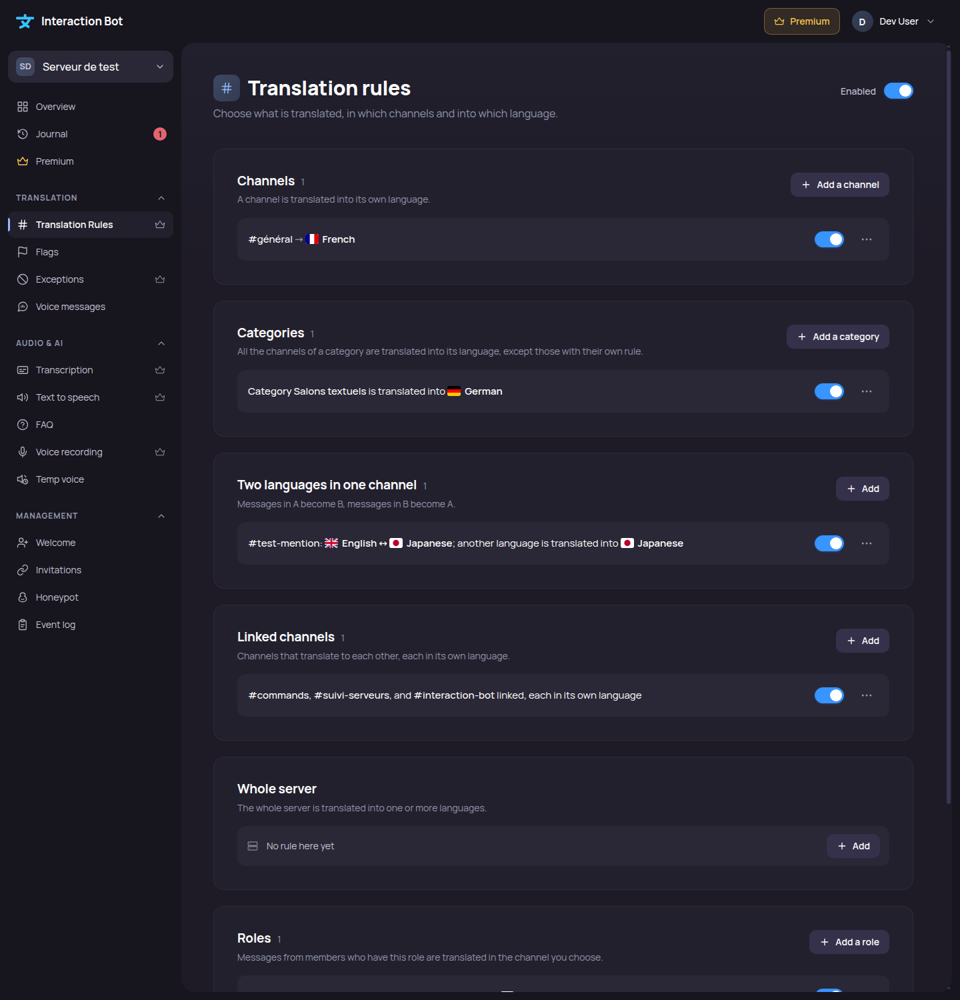

# Translation rules

The **Translation rules** page is the first page of the **Translation** section of the dashboard. It replaces the former Channel, Role, Category and Mirror Translation pages on a server that uses the translation rules. The same rules can be managed with the [`/translation` commands](../../commands/translation.md).

## Localization

**Translation** > **Translation rules** in the sidebar.

<figure><figcaption>
Translation rules page
</figcaption></figure>

## How the rules are applied

When someone writes in a channel:

1. The [Exceptions](blacklist.md) come first (channel, role, message too short, excluded language). If one of them applies, nothing is translated.
2. Otherwise the rule of the **channel** applies, then the rule of its **category**, then the rule of the **server**: the most precise one wins. Rules by **role** and **linked channels** are added to them.
3. A message already in the target language is not translated again (turn on *Send even if the text seems already translated* in a rule to change it).

A flag reaction follows the style of the channel and ignores the exceptions.

## Types of rules

Click **Add a rule** and choose a type, or use the **Add** button of a section:

| Type | What it does |
|---|---|
| **Whole server** | The whole server is translated into one or more languages. |
| **Channels** | A channel is translated into its own language(s). |
| **Two languages in one channel** | Messages in language A become B, and messages in B become A. You can also choose what happens to a message that is in neither language (translated into a language, or not translated). |
| **Linked channels** | Channels that translate to each other, each in its own language. |
| **Roles** | Messages of the members who have a role are translated, in the channel you choose. |
| **Categories** | All the channels of a category are translated, except those with their own rule. |

A channel can only appear once: if it already has a rule, the page offers to **Replace** it.

## Options of a rule

The popup asks for the channel (or category, or role) and the languages, then the details you often change. **More options** holds the rest:

* **Send style**: as the author (name and avatar), as a bot message, as a bot card (embed), or in a thread under the original message. The thread style needs the same channel and keeps the original message.
* **Send the translations to**: the same channel (default) or another channel.
* **Delete the translation after**: never, automatically after the reading time, or after a number of seconds.
* **Delete the original message**: needs the **Manage Messages** permission.
* **Translate bots**: Premium.
* **Send even if the text seems already translated**.

Every rule is shown with a sentence that describes it, and can be paused, copied to other channels, edited or deleted. A rule that needs a permission the bot does not have is flagged, with the missing permissions.

## Limits

* **30 rules** and links per server, **200** with Premium.
* Up to **25 languages** per rule, but a message is translated into **3 languages** at most (**20** with Premium): the next translations are not sent. If a rule goes over this, a notice at the top of the page lists the affected channels, with a **See Premium** button on a free server.
* Linked channels: the page shows the maximum number of channels per link and of links per server.

## Tools

* **Try it**: choose a channel and type a sentence (300 characters at most) to see which rules would translate it and into which language. Without a sentence, it lists the rules that apply to the channel. The test uses the saved rules.
* **Check a channel** (*Why isn't this channel translating?*): shows what works and what blocks the translation (translation off, exceptions, minimum size, missing permissions, missing destination channel).
* **Help**: examples of common setups, with the dashboard steps and the matching command.

## Saving

Changes are saved from the page. If saving fails, the page shows *Saving failed. Your changes are still here: try again.*; if your session has expired, sign in again to save.

## See also

* [Flags](flag-translation.md) and [Exceptions](blacklist.md), the other pages of the Translation section.
* [Translation rules commands](../../commands/translation.md).
