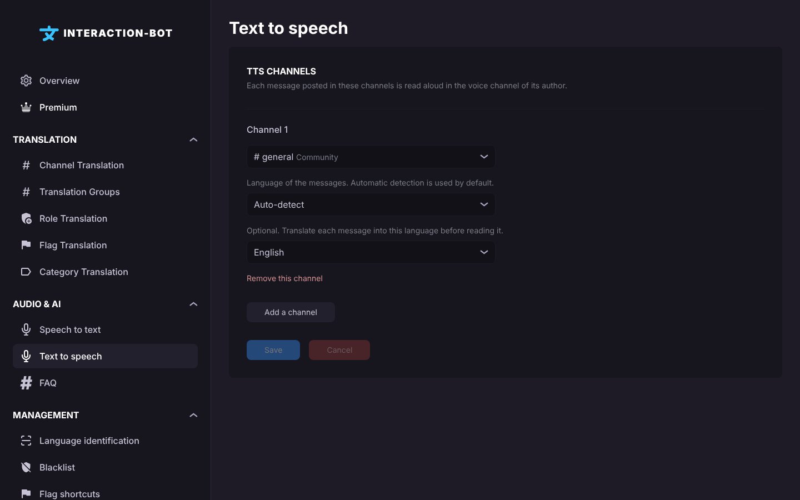

# Text to speech

<figure><figcaption>
Text to speech page
</figcaption></figure>

## Localization

Navbar > category _**Audio & AI**_ > _**Text to speech**_.

## What it does

Each message posted in a TTS channel is **read aloud in the voice channel of its author**: the bot joins the member's voice channel when needed. Only the members who are in a voice channel are read. The same can be done with the command [`/tts-channel`](../../audio/voice.md#tts-channels).

The page lists the **TTS channels** of the server. The list is saved as a whole: each _Save_ replaces the previous list.

## Configure a TTS channel

Click on _**Add a channel**_ and set:

* **Channel**: a text channel of the server. A channel can be used only once.
* **Language of the messages**: _Auto-detect_ (default) or a language. With _Auto-detect_, the language is detected for each message.
* **Translate to** (optional): translate each message into this language before it is read. Default: _No translation_.

Click _**Remove this channel**_ to stop reading a channel. When you are done, click _**Save**_. _**Cancel**_ restores the last saved list.

After a save, the bot reloads the channels at once: no restart is needed.

## Limits

| Free       | Premium     |
| ---------- | ----------- |
| 5 channels | 25 channels |

Adding a channel beyond the limit opens the premium window.

## What is read

* Messages are read **up to 200 characters**. A longer message is not read.
* Messages from bots, messages without text (attachments only) and messages starting with `/`, `!`, `.` or `$` are not read.
* Links are removed and mentions are read as names.
* A member who posts many messages very quickly is **temporarily ignored**: 5 messages with an average gap under 1.5 seconds block this member for 10 seconds. A channel that receives 10 messages with an average gap under 0.5 second is paused for 5 seconds.
* Messages are read one after the other. Up to 5 messages can wait in the queue of the voice channel.

## Access

Voice features need a **premium server**, or a **[top.gg vote](https://top.gg/bot/893494390142697493/vote)** from a member of the server in the last 24 hours. When neither is true, the bot posts a message asking for a vote in the TTS channel, at most once a day.


The bot must be able to view the channel and read its messages, and to connect and speak in the voice channels. See [Voice troubleshooting](../../audio/voice-troubleshooting.md) for the messages and fixes, and [Voice guides](../../audio/voice-guides.md#2-read-a-text-channel-aloud-tts-channel) for a step by step setup.

