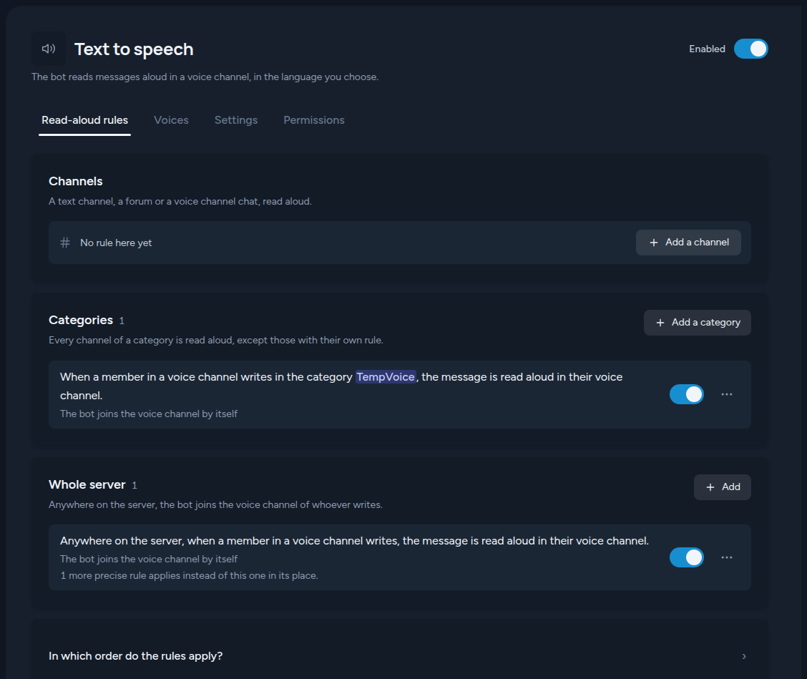
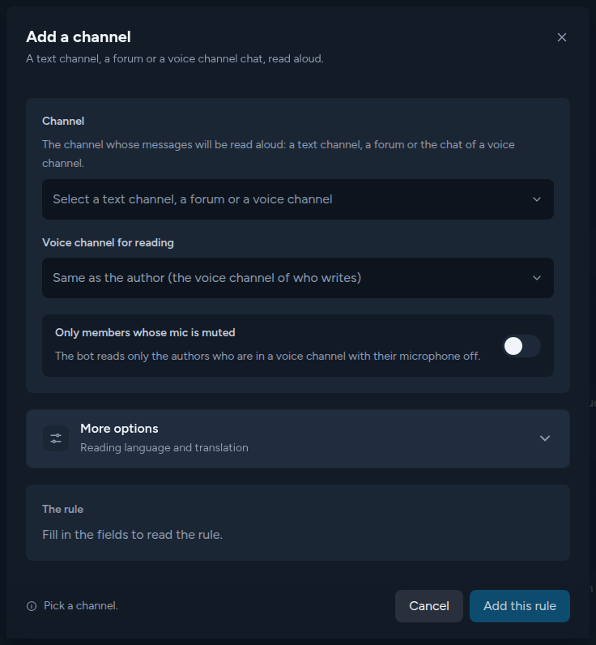

# Text to speech

<figure><figcaption>
The Text to speech page
</figcaption></figure>

The Text to speech page sets what the bot reads aloud in the voice channels of your server, how it reads it, which voices it uses, and who may use each feature. The bot can read a text channel, a category, or the whole server: a message written in one of them is read in a voice channel. The same reading options also apply to a session started with [`/tts start`](../../audio/voice.md#tts-start-session).

## Localization

Navbar > category _**Audio & AI**_ > _**Text to speech**_.

The page has four tabs:

* **Read-aloud rules**: the rules that say which messages are read (below).
* **Voices**: the voices the bot can use, their order, and the gallery of the characters.
* **Settings**: the reading options of the server, the prefix and the language detection.
* **Permissions**: who may use each feature.

The switch next to the title turns the feature on or off for the whole server.

## Read-aloud rules

A rule says **which messages are read**. The tab has three sections, one for each level, each with its own **Add** button:

| Section | Rule | What is read |
| --- | --- | --- |
| **Channels** | Add a channel | The messages of one text channel, forum or voice channel chat. |
| **Categories** | Add a category | Every channel of a category, except those with their own rule. |
| **Whole server** | Add | Anywhere on the server: when a member in a voice channel writes, the bot joins that voice channel by itself and reads the message. |

The most precise rule wins: the rule of the channel, then the rule of its category, then the rule of the whole server. A paused rule is skipped: the next one applies.

Each rule opens a window with these fields:

* **Channel** (or **Category**): the channel or the category to read.
* **Voice channel for reading** (channel rules only): the voice channel where the messages are read. Default: *Same as the author*, the voice channel of the person who writes. The bot only joins a channel where someone is.
* **Only members whose mic is muted** (switch): the bot reads only the members who are in a voice channel with their microphone off. They cannot talk, so they write instead.
* **Language** (in the more options): *Auto-detect* (default), or a language. With *Auto-detect*, the language is detected for each message.
* **Automatic translation** (in the more options, **premium**): translates each message before it is read. Default: *No translation*. On a free server the field is locked and says *Reserved for premium servers.*

A channel can be used only once. When several rules apply to a message, see the order above.

<figure><figcaption>
The window of a text to speech rule
</figcaption></figure>

### Limits of the rules

| Free | Premium |
| --- | --- |
| 5 rules | 25 rules |

The limit counts all the rules of the server, whatever their level. Adding one more shows *Limit reached: 5 channels at most on this server.* (or 25 with premium). The translation before reading is a premium feature.

When you are done, click **Save** in the bar at the bottom of the page. **Cancel** restores the last saved rules. After a save, the bot reloads the rules at once: no restart is needed.

## Settings

The **Settings** tab holds the reading options. Each has a switch, and all the settings of the tab are saved with the same bar.

### Reading

| Option | Default | What it does |
| --- | --- | --- |
| Say who wrote | On | Says "Alex said" when the author changes. |
| Ignore bots | On | Messages written by bots are not read. |
| Ignore the audience of stages | On | Messages from the audience of a stage channel are not read. |
| The author must be in the voice channel | Off | Only reads the members who are in the voice channel where the bot is. |
| Skip emojis | Off | Emojis are removed before reading. |
| Members can choose their voice | On | `/tts voice` works on the server. |
| Cloned voices allowed | On | Premium members can read with their own cloned voice. |
| Read translations aloud | On | **Premium.** On a premium server, the translations made by the bot are read after the original message, with the voice of the server. |
| Read mentions as words | On | A mention is read "mention <name>" in the language of the server, instead of "@name". |
| Expand chat abbreviations | On | Abbreviations like *idk*, *lol* or *vc* are read as full words, because the voices do not know them. |
| Different voice for each member | On | In a `/tts start` session, every member is read with a voice of their own. Off: everybody has the voice of the server. |

**Prefix** (optional): when set, only the messages that start with it are read, and the prefix itself is not read. Leave it empty to read every message.

The options of this tab apply both to the read-aloud rules and to the sessions of `/tts start`.

### Language detection

**Language detection** sets how many messages the bot looks at to find the language of a message: *The message alone* (1), or the last 2 to 10 messages of the author, in this channel first, then elsewhere on the server. A short message such as *lol* or *ok* is read in the right language with the help of the author's previous messages. The same setting is used by the translation.

### What is read

These options are in cards of their own, below the Reading card.

* **What to read**: a notice for a photo or a file (*sent a photo*), for a forwarded message, for a reply (*Alice replied to Bob*), the title of a link (*sent a Wikipedia link*), the hidden text of a spoiler, and the Discord names instead of the nicknames.
* **When many people write**: **Read at the same time** (the voices overlap instead of waiting), and **Split left and right** (overlapping voices are split between the left and right ears; it needs *Read at the same time*).
* **Reading rules**:
  * **Message length limit**: a longer message is replaced by *The message is too long to read.* The limit is a number of characters (1 to 2000, default 200) or a reading time (1 to 120 seconds).
  * **Roles to read**: only the members who have one of these roles are read. Empty: everyone.
  * **People not to read**: the messages of the members added by their Discord ID are not read (100 members at most).
* **Bot and webhook messages**: with *Ignore bots* off, bots are read. These options go further:
  * **Read webhook messages**: also reads the posts made by webhooks.
  * **Add names**: reads the name of the sender before a bot or webhook message.
  * **Bots to read**: with bots read, only the bots added here are read. Empty: every bot.
  * **Channels to read, per bot**: a bot set here reads only in its own channels (10 bots at most).
* **Read messages** (delete): **Delete read messages** removes a message after it was read, once the **Delete after** delay has passed (1 to 600). The bot needs the *Manage Messages* permission.
* **Reading style**: the **pitch** (-4.0 to 4.0, default 0.0), the **speed** (0.5 to 2.0, default 1.0), and **Natural voice**, which keeps repeated exclamation and question marks as typed, so that the voice can stress them.


The reading style has a **Reset to defaults** button. Changes apply from the next message.


## Voices

The **Voices** tab lists every voice the bot can use, in the order it gives them. Drag a voice to move it, use the arrow keys, or switch it off. The first enabled voice is the **default voice**: it is used by `/tts say`, by the rules when nobody has chosen a voice, and by the messages of the bot itself (*Léa said*, the transcription and recording notices). At least one voice must stay enabled.

Members choose their own voice with `/tts voice`, when the switch *Members can choose their voice* is on. Each voice can be listened to with its sample. The **voice gallery** has a search and filters (language, engine, category), and each character shows its credit, which must be kept when the voice is used.

See [Voices and cloning](../../audio/voices-and-cloning.md#the-voice-catalogue) for the catalogue, and the cloned voices of the members.

## Permissions

The **Permissions** tab has three rules. Each one is set to *Everyone* or *Only the chosen roles and members*:

| Rule | Command | Who it allows |
| --- | --- | --- |
| **Start and stop** | `/tts start`, `/tts stop` | Who can make the bot join or leave a voice channel for a session. |
| **Automatic reading** | Messages read in a session | Whose messages are read automatically. |
| **Choose a voice** | `/tts voice` | Who can change the voice used for their messages. |

For *Only the chosen roles and members*, choose roles, or add members by their Discord ID. Members with the *Manage Server* permission are always allowed.

## Limits

| | Free | Premium |
| --- | --- | --- |
| Rules | 5 | 25 |
| Daily text to speech time (per server, UTC day) | 30 minutes | 3 hours |
| Reading translations aloud | No | Yes |
| Cloned voices | No | Yes, see [Voices and cloning](../../audio/voices-and-cloning.md) |

Voice features need a **premium server**, or a **[top.gg vote](https://top.gg/bot/893494390142697493/vote)** from a member of the server in the last 24 hours. When neither is true, the bot asks for a vote in the channel, at most once a day.

## What is read

* A long message is split into parts, read one after the other. Only the first 4000 characters of a message are read.
* Messages without text (attachments only) and messages starting with `/`, `!`, `.` or `$` are not read. The reading options above decide about the bots and webhooks.
* A member who posts many messages very quickly is **temporarily ignored**: 5 messages with an average gap under 1.5 seconds block this member for 10 seconds. A server that receives 10 messages with an average gap under 0.5 second is paused for 5 seconds.
* Up to 40 parts of messages can wait to be read on the server. Beyond that, a new message is not read.

## Messages of the page

| Message | Meaning |
| --- | --- |
| *Configuration saved.* | The rules and the settings are saved. |
| *Settings saved.* | The settings of the tab are saved. |
| *Voices saved.* | The order and the switches of the voices are saved. |
| *The configuration could not be saved.* / *The settings could not be saved.* | Try again. |
| *One of the channels cannot be read aloud (use a text channel, a forum or a voice channel).* | The channel was deleted, or it is not a kind that can be read. |
| *The voice channel chosen to read the messages does not exist anymore.* | Choose another voice channel for reading. |
| *A channel can only be used once.* | The same channel is in two rules. |
| *The server has reached the limit of channels.* | Remove a rule, or get premium. |
| *At least one voice must stay enabled.* | Switch on another voice first. |
| *One of the roles does not exist anymore. Remove it and save again.* | A role was deleted. Remove it from the list. |


The bot must be able to view the channel and read its messages, and to connect and speak in the voice channels. See [Voice troubleshooting](../../audio/voice-troubleshooting.md) for the messages and fixes, and [Voice guides](../../audio/voice-guides.md#2-read-a-text-channel-aloud-tts-rule) for a step by step setup.

