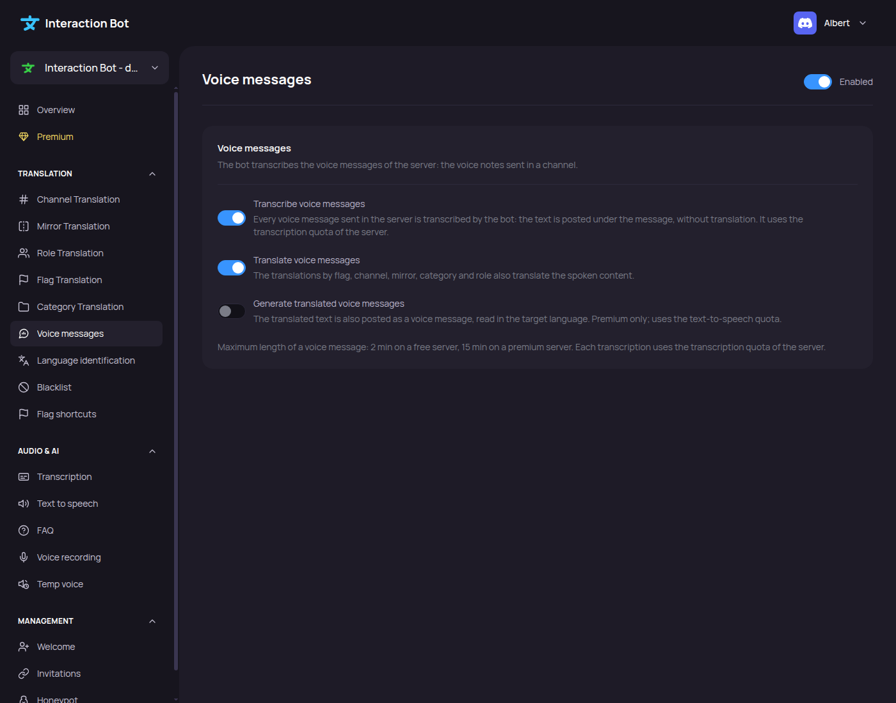

# Voice messages

<figure><figcaption>
Voice messages page
</figcaption></figure>

The **Voice messages** page sets how the bot handles the voice messages sent in the server: transcription under each message, translation, and dubbing. What the feature does is explained in [Voice messages](../../audio/voice-messages.md).

## Localization

Navbar > category _**Translation**_ > _**Voice messages**_.

## Settings

The page has three switches and a line of information. Click _**Save**_ to store the changes, or _**Cancel**_ to restore the last saved settings.

| Field | Default | What it does |
| --- | --- | --- |
| **Transcribe voice messages** | Off | Every voice message of the server is transcribed by the bot, and the text is posted under the message. The text is not translated. Uses the speech to text quota of the server. |
| **Translate voice messages** | On for a Premium server, Off for a free server | The translations by flag, channel, mirror, category and role also translate the spoken content of a voice message. **Premium only.** On a free server the switch cannot be turned on. |
| **Generate translated voice messages** | Off | The translated text of a voice message is also posted as a voice message, read in the target language. **Premium only.** Uses the text to speech quota of the server. |

The line under the switches is information only. It shows the maximum length of a voice message: **2 minutes** on a free server and **15 minutes** on a Premium server. Each transcription uses the speech to text quota of the server.

### How the settings combine

* **Transcribe voice messages** needs the transcription feature of the server to be on (see [Speech to text](speech-to-text.md)).
* **Translate voice messages** only has an effect on the translation features: [Flag translation](flag-translation.md), [Channel translation](channel-translation.md), [Translation groups](translation-groups.md), [Category translation](category-translation.md) and [Role translation](role-translation.md).
* **Generate translated voice messages** needs **Translate voice messages** to be on, and the text to speech feature of the server (see [Text to speech](tts-channels.md)).

The bot uses the saved settings at once.

## Save and cancel

When there are unsaved changes, a bar at the bottom of the page says _You made changes, save them!_ with the buttons _**Cancel**_ and _**Save**_. _**Save**_ stores the settings, and the message _Voice message settings saved._ confirms it.

## Messages of the page

| Message | Meaning |
| --- | --- |
| _Premium only: the translation of voice messages is reserved for premium servers._ | The switch **Translate voice messages** is on, but the server is not Premium. Get Premium, or turn the switch off. |
| _Premium only: the voice dubbing is reserved for premium servers._ | The switch **Generate translated voice messages** is on, but the server is not Premium. |
| _The configuration could not be saved._ | The settings were not stored. Try again. |


The page only saves the settings. The permissions the bot needs for the transcription feature are listed in [Permissions](../../permissions.md). The commands and menus of voice messages are in [Voice messages](../../audio/voice-messages.md#commands-and-menus).

