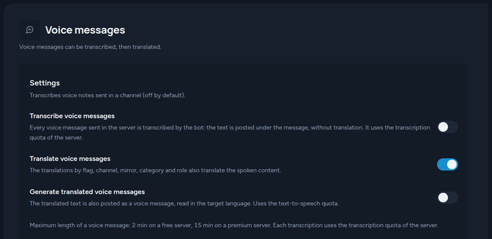

# Voice messages

The **Voice messages** page sets how the bot handles the voice messages sent in the server: transcription under each message, translation, and dubbing. What the feature does is explained in [Voice messages](../../audio/voice-messages.md).

<figure><figcaption>
The Voice messages page
</figcaption></figure>

## Localization

**Translation** > **Voice messages** in the sidebar, at `/dashboard/{guild}/translation/voice`.

## Settings

The **Settings** card has three switches and a line of information. Click **Save** to store the changes, or **Cancel** to restore the last saved settings.

| Field                                    | Default                                                | What it does                                                                                                                                                                                  |
| ---------------------------------------- | ------------------------------------------------------ | --------------------------------------------------------------------------------------------------------------------------------------------------------------------------------------------- |
| **Transcribe voice messages**            | Off                                                    | Every voice message of the server is transcribed by the bot, and the text is posted under the message. The text is not translated. Uses the transcription quota of the server.               |
| **Translate voice messages**             | On for a Premium server, Off for a free server         | The translations by flag reaction, translation rules and linked channels also translate the spoken content of a voice message. **Premium only**: on a free server, the switch cannot be turned on. |
| **Generate translated voice messages**   | Off                                                    | The translated text of a voice message is also posted as a voice message, read in the target language. **Premium only.** Uses the text-to-speech quota of the server.                             |

The line under the switches is information only. It shows the maximum length of a voice message that the bot transcribes: **2 minutes** on a free server and **15 minutes** on a Premium server. Each transcription uses the transcription quota of the server.

### How the settings combine

* **Transcribe voice messages** needs the transcription feature of the server to be on, see [Speech to text](speech-to-text.md). Without it, the switch is unavailable and the page says so.
* **Translate voice messages** only has an effect on the translations: [Flags](flag-translation.md), the [translation rules](translation-rules.md), and the linked channels of the rules.
* **Generate translated voice messages** works on a translated voice message, so it needs the translation to be on, and the text-to-speech feature of the server, see [Text to speech](tts-channels.md). If no voice speaks the target language, nothing is read.

The bot uses the saved settings at once.

## Save and cancel

When there are unsaved changes, a bar at the bottom of the page says *You made changes, save them!* with the buttons **Cancel** and **Save**. **Save** stores the settings, and the message *Voice message settings saved.* confirms it.

## Messages of the page

| Message                                                                                                                  | Meaning                                                                                                                       |
| ------------------------------------------------------------------------------------------------------------------------ | ----------------------------------------------------------------------------------------------------------------------------- |
| *Premium only: the translation of voice messages is reserved for premium servers.*                                        | The switch **Translate voice messages** is on, but the server is not Premium. Get Premium, or turn the switch off.           |
| *Premium only: the voice dubbing is reserved for premium servers.*                                                        | The switch **Generate translated voice messages** is on, but the server is not Premium.                                       |
| *Transcription is off: the Transcription extension is turned off on this server, so this option is unavailable.*         | Turn on the [Speech to text](speech-to-text.md) extension to use **Transcribe voice messages**.                               |
| *The configuration could not be saved.*                                                                                  | The settings were not stored. Try again.                                                                                      |


The page only saves the settings. The permissions the bot needs for the transcription feature are listed in [Permissions](../../permissions.md). The voice messages themselves, and the commands that go with them, are described in [Voice messages](../../audio/voice-messages.md).

