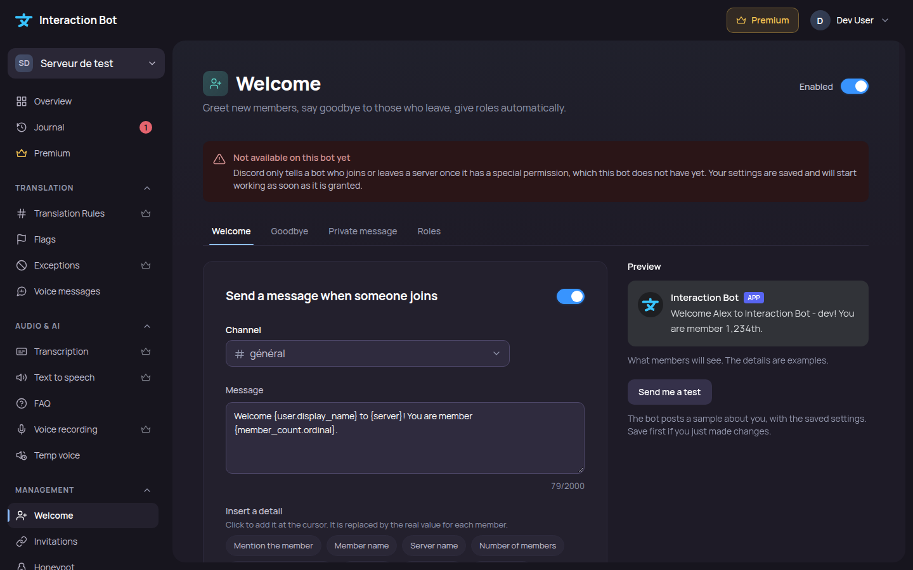

# Welcome

<figure><figcaption>
Welcome page
</figcaption></figure>

The Welcome page sets the messages the bot sends when a member joins or leaves the server, the private message to new members, the banners and the automatic roles. For how the feature works, the variables and the limits, see [Welcome and goodbye](../../management/welcome-and-goodbye.md).

Navbar > section _**Management**_ > _**Welcome**_.

## Quick start

On a server where the Welcome page has never been saved, and where no message is turned on, the page shows a single question:

| Field | Default | What it does |
| --- | --- | --- |
| **Channel for welcome messages** | Nothing chosen | The text channel where the welcome message is posted. |
| _**Turn on welcome messages**_ (button) | Disabled until a channel is chosen | Turns on the welcome message in this channel, with a default text. The goodbye and private message texts are also filled in, but these two messages stay off. |

After the quick start, the page shows the four tabs. Click _**Save**_ to keep the settings.

## Sections

The page has two levels of navigation, so only one small part is on screen at a time.

| Group | Sections |
| --- | --- |
| _**Messages**_ | _**Welcome**_, _**Goodbye**_, _**Private message**_ |
| _**Roles and events**_ | _**Roles**_, _**Boost**_, _**Role gained or lost**_ |
| _**Welcome hub and rules**_ | the welcome hub and the _**Rules**_ |
| _**Settings**_ | _**Settings**_, _**Problems**_ |

A small dot before a message tells if it is on. Each message is split into three parts: _**Message**_ (what is written), _**Sending**_ (delay, deletion, who and when) and _**Variants**_ (more texts drawn at random). The preview only shows next to the _Message_ part.

**Browser history.** Each click on a group, a section or a part is written in the browser history: the back arrow goes back to the previous section of the page, not to another page of the dashboard. The address keeps it (`?tab=leave&part=sending`), so a link opens the same place.

The first switch of each message tab turns the message on or off. While it is off, the rest of the tab is hidden, and the preview is hidden too. ## Write the message with the builder

Every message of the page is written with the **message builder**, the same editor as the [reaction roles](reaction-roles.md) and [temp voice](temp-voice.md) messages: the welcome, goodbye and private messages, the **variants**, the goodbye of a **kick** and of a **ban**, the **boost** and **role** messages, and the message of the **welcome hub**. You write the message where it appears: embed or card, several embeds, fields, images (by link or by drag and drop), link buttons, free layout with blocks, undo, import and export of JSON. See [Message builder](message-builder.md). The _{ }_ button lists the variables of the message with their description (`{user}`, `{user.display_name}`, `{server}`, `{member_count}`, `{inviter}`…; a boost message has `{boosts}`, a role message `{role}`, the hub only `{server}`), and the preview replaces them by an example. The avatar of the member, the icon of the server and the avatar of the bot can be used as images.

* **Templates.** The _**Message templates**_ menu starts with the page's own templates (_Friendly_, _Gaming_, _Chill_, _Community_): one click **replaces** the message with a finished one (an embed with its text and color) and turns on the banner with the template's background. A template that writes a detail the message does not have (the inviter in a boost message) is not offered. The generic templates (card, announcement, rules, columns…) follow.
* **Banner of the bot.** Under the message, a switch turns on the **welcome banner**: an image drawn by the bot (the member's avatar, a title and a subtitle, a background of your choice, or your own layout) attached to the message as its main picture. It has its own preview. **You choose where it goes**: click any image of the message (thumbnail, large image, message image, an image block) and pick _**Welcome banner**_ in the list of variables; without a choice, it is the large image of the message. In the **free layout** the bot does not place it by itself: put it in an image block (click the picture, _Welcome banner_), inside the card or outside it, in the order you want. The preview shows the **real banner** the bot draws for your settings (with your own avatar). On the hub, the same place holds the _background picture_ (one of the pictures of the bot).
* **Messages written before.** Their text, embed (title, text, footer, color, image, avatar as thumbnail) and banner are taken over by the builder when the page opens, and the page is not "modified" for that. A message turned on with nothing written starts as a real text to correct (an embed with a title and a text).
* **Options.** _Mention the new member_ and _Delete the message automatically_ stay under the message of the arrival. The button _**Send me a test**_ posts a real message from the saved settings, with the case to simulate (it replaces the preview column: the builder has its own preview).
* **Buttons.** The link buttons of the hub, « I accept » and « Read in my language » are under an embed or a text; in a card or a free layout they are rows of buttons in the layout itself. If Discord refuses to edit the hub message because it changed from an embed to a card (or back), the bot deletes it and sends a new one.

### Welcome

The welcome message is posted in a channel when a member joins.

| Setting | Default | What it does |
| --- | --- | --- |
| **Send a message when someone joins** | Off | Turns the message on. A message turned on with nothing written starts as an embed with the title _Welcome!_ and the text _Welcome {user} to {server}! You are our {member_count.ordinal} member._, to correct. |
| **Channel** | Nothing chosen | A text channel or an announcement channel. A channel is required when the message is on. |
| **Message** | The text above | Written with the [builder](#write-the-message-with-the-builder). Up to **4000** characters of text. |
| **Mention the new member** | On | The member is mentioned and notified. Off: the name is written as text, nobody is notified. |
| **Delete the message automatically** | Never | The welcome message is deleted after 10 seconds, 30 seconds, 1 minute, 5 minutes or 1 hour. _Never_ keeps it. This option is only on the Welcome tab. |
| **Welcome banner** | Off | Sends a banner with the message: see [Banner](#banner). |

### Goodbye

The goodbye message is posted in a channel when a member leaves. The member is named, not pinged.

| Setting | Default | What it does |
| --- | --- | --- |
| **Send a message when someone leaves** | Off | Turns the message on. When it is turned on with an empty text and no card, the text _{user.display_name} left the server._ is written. |
| **Channel** | Nothing chosen | A text channel or an announcement channel. A channel is required when the message is on. |
| **Message** | The text above | Written with the [builder](#write-the-message-with-the-builder). The member is named, not pinged: `{user}` shows the name. |
| **Goodbye banner** | Off | Sends a banner with the message. Default texts: title _Goodbye {user.display_name}!_, subtitle _We are now {member_count} members_. |

There is no automatic deletion on the Goodbye tab.

### Private message

The private message is sent to the new member, in private messages. It needs no channel.

| Setting | Default | What it does |
| --- | --- | --- |
| **Send a private message to new members** | Off | Turns the private message on. Nothing happens if the member closed their private messages. When it is turned on with an empty text and no card, the text _Welcome to {server}, {user.display_name}! Take a look at the rules and enjoy your stay._ is written. |
| **Message** | Empty | Up to **2000** characters. |
| **Banner with the private message** | Off | Sends a banner with the message. Default texts: title _Welcome to {server}!_, subtitle _Glad to have you with us_. |

There is no automatic deletion on the Private message tab.

### Banner

The banner is a picture of **1000 × 350 px**, with the avatar of the member, a title and a subtitle. It is turned on with the switch of the _**Welcome banner**_ section, under the message of each tab (and of each variant, goodbye by kind, boost and role message). The bot draws it for **each** new member and attaches it to the message; you choose where it goes (see above), and without a choice it is the large image of the message.

The section offers two ways:

* **Ready-made templates**: _Classic_, _Neon_, _Sakura_, _Starry_, _Lo-fi_, _Sunset_, _Mountain_, _Glass_, _Candy_, _Minimal_, _Manga_ and _Invited_ (who invited the member, welcome only). Each one is a style: the background, the colors, the avatar frame, the fonts and the place of the texts go together, and each shows a live preview. One click chooses it. The _Banner title_ and _Banner subtitle_ fields then change the texts, and the layout follows as long as it is the one of the template.
* **_Create my own layout_**: the free editor (avatar, texts, shapes, pictures placed where you want, every element movable). Once the layout has been changed there, no template follows it any more.

_**Change the background or use a picture**_ (folded) holds the other backgrounds (gradients, pictures of the bot, a solid color, your own pictures, 10 per server) and _Use the picture as the whole banner_.

### Preview

The builder shows the message as Discord will display it (_**Preview**_): the server name is the name of your server, the member name is the example _Alex_, and the member count is the example 1,234. The banner has its own preview in its section; it is drawn in the page, so it can be a little different from the real one. Use _**Send me a test**_ to get the real message.

### Automatic roles

The Roles tab sets the roles given automatically.

| Setting | Default | What it does |
| --- | --- | --- |
| **Roles for new members** | None | Roles given to every new member. At most **10**. |
| **Wait until the member accepts the rules** | On | When the server uses membership screening, the roles are given after the member accepts the rules. Off: the roles are given when the member joins. |
| **Roles for new bots** | None | Roles given to every new bot. At most **10**. |
| **Roles for a member** | None | Extra roles for one member, given when they arrive. The _Member_ field **searches by name** from the first letter (the members of the server are proposed with their avatar); an identifier or a mention pasted also works. At most **50** members, **10** roles each. |

You can only choose a role that you could give yourself (*Manage Roles*, below your highest role) and that has no moderation or administration permission. The page checks the roles you add when you save. The bot checks its own position when it gives a role, not when you save: a role that is not below the highest role of the bot is skipped, and the Journal of the dashboard says so.

### Intent warning

| Message | Shown when | What to do |
| --- | --- | --- |
| _Not available on this bot yet_ | The bot does not have the Server Members intent. | Nothing to do on the page. The settings are saved. See [Server Members intent](../../management/welcome-and-goodbye.md#server-members-intent). |

## Test

The _**Send me a test**_ button is under the preview of each message tab.

| Element | Default | What it does |
| --- | --- | --- |
| **Send me a test** | Disabled while there are unsaved changes | Makes the bot post a sample about you (the welcome or goodbye message in its channel, or the private message to you). |
| Help text | _The bot posts a sample about you, with the saved settings. Save first if you just made changes._ | Shown when no test was sent yet. |
| Result | - | _Test sent._ for a channel message, _Check your private messages._ for the private message. Otherwise the reason (see [Test a message](../../management/welcome-and-goodbye.md#test-a-message)). |

A test welcome or goodbye message is deleted after 2 minutes at most.

## Save

Any change makes a bar appear at the bottom of the page: _You made changes, save them!_, with _**Cancel**_ and _**Save**_.

| Button | What it does |
| --- | --- |
| _**Save**_ | Saves all the tabs at once. The bot uses the new settings right away. |
| _**Cancel**_ | Restores the last saved settings. |

When the save fails, the page shows the reason of the error:

| Message | Cause |
| --- | --- |
| _Choose a text channel of this server._ | The channel was deleted, or it is not a text or announcement channel. |
| _Choose a channel for each message you turn on._ | A message is on, and no channel is chosen (welcome or goodbye). |
| _One of the roles no longer exists._ | A chosen role was deleted. |
| _You can only choose a role you could give yourself (Manage Roles, below your highest role), without moderation or administration permissions._ | The role is not allowed (see [Automatic roles](#automatic-roles)). |
| _The picture chosen for the card no longer exists: choose another background._ | The background picture was deleted. |
| _The picture of the card no longer exists. Choose another one._ | The picture of the card was deleted. |
| _The bot does not answer right now. Try again in a moment._ | The bot is not reachable. Try again. |
| _The settings could not be saved. Try again._ | Any other error. |

## Limits

| Item | Limit |
| --- | --- |
| Message text | 2000 characters |
| Card title | 256 characters |
| Card text | 4096 characters |
| Card footer | 2048 characters |
| Card title, text and footer together | 6000 characters |
| Banner title and subtitle | 120 characters each |
| Text in a custom banner | 200 characters |
| Elements in a custom banner | 20 |
| Pictures in a custom banner | 4 |
| Pictures per server | 10 (20 MB in total) |
| Size of a picture sent | 4 MB, PNG, JPEG or WebP |
| Roles for new members, roles for new bots | 10 each |

The page is free for every server.

## Related pages

* [Welcome and goodbye](../../management/welcome-and-goodbye.md): how the feature works, the variables, the permissions and the troubleshooting.
* [Permissions](../../permissions.md): the permissions of each feature.
