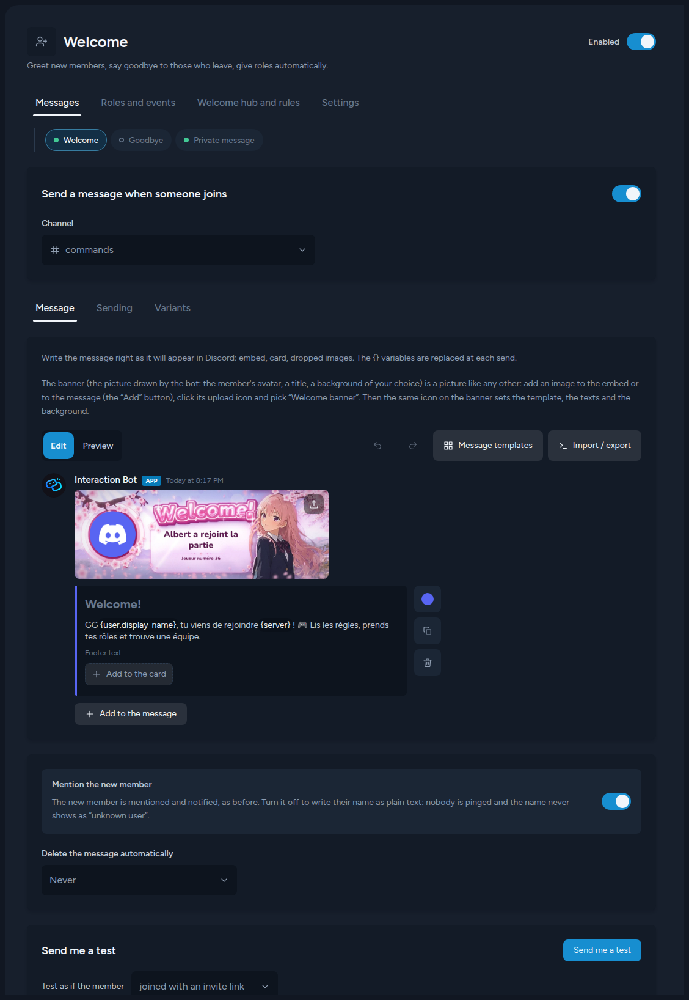
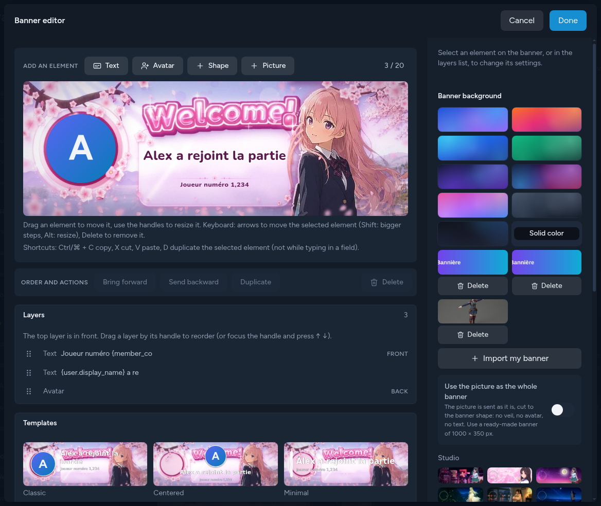
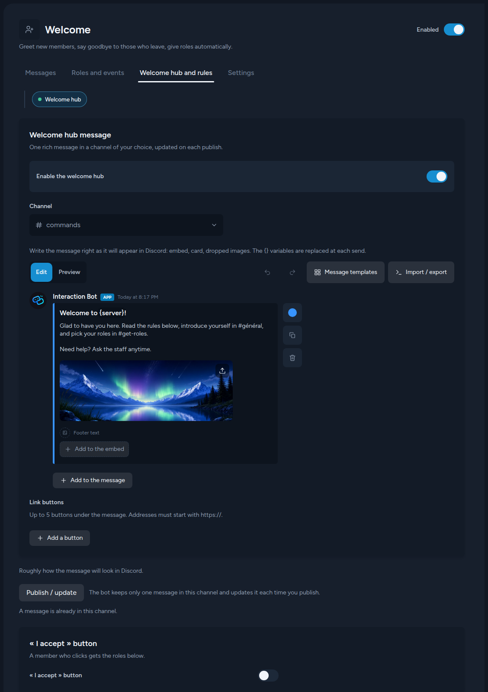

# Welcome

<figure><figcaption>
The Welcome & goodbye page
</figcaption></figure>

The Welcome page sets the messages the bot sends when a member joins or leaves the server, the private message to new members, the messages for boosts and role changes, the automatic roles and the welcome hub. For how the feature works, the variables and the limits, see [Welcome and goodbye](../../management/welcome-and-goodbye.md).

Navbar > section _**Management**_ > _**Welcome**_.

The page is free for every server.

## Quick start

On a server where nothing is configured yet, and where no welcome, goodbye or private message is on, the page shows one question:

| Field | Default | What it does |
| --- | --- | --- |
| **Channel for welcome messages** | Nothing chosen | The text channel where the welcome message is posted. |
| _**Turn on welcome messages**_ (button) | Disabled until a channel is chosen | Turns on the welcome message in this channel, with a default text. The goodbye and private message also get a ready text, but these two stay off. |

After the quick start, the page shows all the tabs. Click _**Save**_ to keep the settings.

## Groups and tabs

The page has two levels of navigation. The first level is a group, the second level is the tab of that group. The state of each message is its switch at the top of its tab.

| Group | Tab | Turns on with |
| --- | --- | --- |
| _**Messages**_ | _**Welcome**_ | _Send a message when someone joins_ |
| _**Messages**_ | _**Goodbye**_ | _Send a message when someone leaves_ |
| _**Messages**_ | _**Private message**_ | _Send a private message to new members_ |
| _**Roles and events**_ | _**Roles**_ | Roles chosen in the tab |
| _**Roles and events**_ | _**Boost**_ | Messages added in the tab (up to 10) |
| _**Roles and events**_ | _**Role gained or lost**_ | Messages added in the tab (up to 10) |
| _**Welcome hub and rules**_ | _**Welcome hub**_ | _Enable the welcome hub_ |
| _**Settings**_ | _**Settings**_ | Numbers and texts of the bot |
| _**Settings**_ | _**Problems**_ | Shows a number when something must be fixed |

The Problems tab shows a banner at the top of the page as long as something needs to be fixed.

## Welcome

The welcome message is posted in a channel when a member joins. The tab has two parts: _**Message**_ (what the message says) and _**Sending**_ (when and to whom it is sent). A third part, _**Variants**_, is described in [Variants](#variants).

### Message

| Setting | Default | What it does |
| --- | --- | --- |
| **Send a message when someone joins** | Off | Turns the message on. |
| **Channel** | Nothing chosen | A text channel or an announcement channel. A channel is required when the message is on. |
| **Message** | Empty | The text of the message, written with the message builder (see [The message builder](#the-message-builder)). Up to **2000** characters. |
| **Insert a detail** | - | Buttons that add a variable at the cursor, such as _**Mention the member**_, _**Member name**_ or _**Member rank (1st, 2nd…)**_. |
| **Mention the new member** | On | The new member is mentioned and notified. Off: the name is written as plain text, and nobody is pinged. |
| **Show the message as a card** | Off | Shows the text as a card: see [Card](#card). |
| **Send a welcome banner** | Off | Sends a banner with the message: see [Banner](#banner). |
| **Delete the message automatically** | Never | The welcome message is deleted after 10 seconds, 30 seconds, 1 minute, 5 minutes or 1 hour. _Never_ keeps it. |

When it is turned on with an empty text and no card, the text _Welcome {user} to {server}! You are our {member_count.ordinal} member._ is written.

### Sending

| Setting | Default | What it does |
| --- | --- | --- |
| **Send the message after a delay** | Right away | The bot waits up to **10 minutes**, then posts the message. If the member leaves in the meantime, nothing is sent. |
| **Delete it if the member leaves quickly** | Never | When the member leaves within 1 minute, 5 minutes, 1 hour or 24 hours of joining, their welcome message is removed. |
| **Minimum account age** | Welcome every account | An account younger than the chosen age (up to **30 days**) gets no public welcome, unless a variant is made for young accounts. |
| **Who is welcomed** | Members only | _Members only_, _Bots only_ or _Members and bots_. For a bot, the variant "bot" is used, and `{inviter}` is the person who added it when the bot can read the audit log. |
| **Ghost mention** | None | The new member is mentioned in up to **5** channels, and the mention is deleted after 1 to 30 seconds (5 seconds by default): a gentle way to show where to go. |
| **Reactions on the welcome** | None | Up to **2** emojis added under the message. The bot needs *Add Reactions* and *Read Message History*. |
| **Buttons under the message** | Off | Three buttons, answered in private: _Say hello_ (a greeting drawn in the language of the person who clicks), _Read in my language_ (the message translated for them) and _See the rules_ (shown only when the server has rules). Each has a color and an emoji. |
| **Pause during a raid** | On | While the server is in raid mode, no public welcome, no ghost mention and no private message is sent. The goodbye messages, the roles and the invitation tracking go on. |

## Goodbye

The goodbye message is posted in a channel when a member leaves. The member is named, not pinged. The tab has the same _**Message**_ part as the Welcome tab (without the mention and the automatic deletion), and a _**Sending**_ part:

| Setting | Default | What it does |
| --- | --- | --- |
| **Send a message when someone leaves** | Off | Turns the message on. When it is turned on with an empty text and no card, the text _{user.display_name} left the server._ is written. |
| **Channel** | Nothing chosen | A text channel or an announcement channel. |
| **Only after a minimum stay** | Always | The goodbye is sent only when the member stayed at least 1 hour, 1 day or 7 days. A member who arrived before the last restart of the bot is not counted. |
| **A goodbye for a kick and for a ban** | - | Each case has its own message and channel. Without it, the general goodbye is used. A kick needs the *View Audit Log* permission to be told apart from a normal departure. |

There is no automatic deletion on the Goodbye tab.

## Private message

The private message is sent to the new member, in private messages. It needs no channel.

| Setting | Default | What it does |
| --- | --- | --- |
| **Send a private message to new members** | Off | Turns the private message on. Nothing happens if the member closed their private messages. When it is turned on with an empty text and no card, the text _Welcome to {server}, {user.display_name}! Take a look at the rules and enjoy your stay._ is written. |
| **When the message is sent** | At once | _At once_, _After the member accepts Discord's rules_ (membership screening) or _After the member finishes the Onboarding_. A message waits at most **30 minutes**, and survives a restart of the bot. |
| **Message** | Empty | Up to **2000** characters. |
| **Show the message as a card** | Off | Same as the Welcome tab. |
| **Send a banner with the private message** | Off | Sends a banner with the message. Default texts: title _Welcome to {server}!_, subtitle _Glad to have you with us_. |

The private message has no channel and no variants. It is sent before the public welcome message, and each member receives at most one private message a day.

## Variants

The Welcome and Goodbye tabs can hold **variants**: instead of always the same message, the bot picks one at random among the main message and the variants. Each variant has a **weight** from 1 to 100 (how often it comes up) and optional conditions. Each box filled must be true for the variant to be a candidate. The most specific variant wins, then one is drawn by weight.

| Condition | Matches a member who… |
| --- | --- |
| _with an invite link_, _with the custom server link_, _from an unknown source_, _while the bot cannot see invites_ | arrived that way |
| _Invite labels_ | arrived with an invite that has one of these labels |
| _as a bot_ | is a bot |
| _Account younger than (hours)_ | has a young account |
| _A former member who comes back_ | has been on the server before |

There can be up to **20** variants for each message. _**Never the same message twice in a row**_ avoids repeats.

On the Goodbye tab, variants of the kicks and bans are chosen in _**A goodbye for a kick and for a ban**_. A goodbye cannot know how the member arrived, so the conditions about the arrival do not apply to it.

## The message builder

The text of each message is written with the message builder, as it will appear in Discord: text, card, banner, pictures dropped into the message. The builder has a text of up to **2000** characters, a card title of up to **256** characters, up to **25** fields and up to **10** cards in a message. A free layout holds up to **25** blocks and **10** pictures of the gallery. The _**Templates**_ fill the text and the banner with a ready style (_Friendly_, _Gaming_, _Chill_, _Community_). Nothing is saved until you press _**Save**_, and you can still change everything.

## Card

The card is shown when _**Show the message as a card**_ is on.

| Setting | Default | What it does |
| --- | --- | --- |
| **Title** | Empty | The title of the card. Up to **256** characters. |
| **Text of the card** | Empty | The body of the card. Up to **4096** characters. |
| **Color** | Blue (`#3894FE`) | The color of the edge of the card. |
| **Show the member's avatar** | On | Shows the avatar of the member as a small picture. |
| **Picture of the card** | None | A large picture at the bottom of the card. Recommended size: **1200 × 675 px** (16:9). |
| **Small text at the bottom** | Empty | The footer of the card. Up to **2048** characters. |

The title, the text and the footer together cannot be more than **6000** characters (the limit of Discord).

## Banner

A banner is a picture of **1000 × 350 px**, drawn by the bot for each new member, with the avatar of the member, a title and a subtitle. It is turned on with the _**Send a … banner**_ switch of each tab.

| Setting | Default | What it does |
| --- | --- | --- |
| **Show the banner inside the card** | On | Shown only when the message is a card. On: the banner is the picture of the card. Off: the banner is sent under the message. |
| **Classic layout** or **Custom layout** | Classic layout | Classic: the avatar, the title and the subtitle. Custom: the layout made in the banner editor. |
| **Design my own layout** (or **Edit the layout**) | - | Opens the banner editor. _**Back to the classic layout**_ removes the custom layout. |
| **Banner background** | _Aurora_ | A gradient design: _Aurora_, _Sunset_, _Ocean_, _Forest_, _Midnight_, _Neon_, _Candy_, _Slate_ or _Interaction_. Or one of the built-in pictures (grouped by category), a solid color, or one of your pictures. |
| **Your picture** | Empty | PNG, JPEG or WebP, **4 MB** at most. Up to **10** pictures per server, **20 MB** in total. Delete one with its trash button. |
| **Banner title** | _Welcome {user.display_name}!_ (goodbye and private message: their own default) | The big text. Up to **120** characters. No emoji. |
| **Banner subtitle** | _You are the {member_count.ordinal} member_ | The smaller text under the title. Up to **120** characters. |

When a custom layout is saved, the classic title and subtitle are not used. They are kept if you go back to the classic layout.

### Banner editor

<figure><figcaption>
The banner editor
</figcaption></figure>

The editor shows the banner at full size, the list of its elements, the templates and the properties of the selected element.

| Part | What it does |
| --- | --- |
| _**Add an element**_ | _Text_, _Avatar_, _Shape_ or _Picture_. At most **20** elements, and **4** pictures. |
| **Templates** | _Classic_, _Centered_, _Minimal_, _Framed_ and _Invited by_. A template replaces the current layout. |
| **Layers** | The list of the elements. The top one is in front. _**Bring forward**_, _**Send backward**_, _**Duplicate**_ and _**Delete**_ act on the selected element. |
| **Show the real rendering** | Asks the bot to draw the exact banner, about you. Use it to check the result before saving. |
| **Done** | Keeps the layout on the page. It is saved with _**Save**_. |
| **Discard** | Asks _Discard your changes?_, with _**Discard**_ and _**Keep editing**_. |

Element properties:

| Element | Settings |
| --- | --- |
| **Text** | The text (variables allowed, up to **200** characters), font, bold, capitals, letter spacing, size, color, alignment, vertical position, glow, outline, 3D edge and shadow. |
| **Avatar** | Whose picture (_The new member_, _Who invited them_ or _The server icon_), shape (circle, rounded square or square), border width and color, shadow. |
| **Shape** | Rectangle or circle, fill color, a second color for a gradient, opacity, rounded corners and border. |
| **Picture** | One of your pictures, fitted (_Fill the box_ or _Show it all_), rounded corners, opacity and border. |

Every element has its position and size in percent of the banner, with _**Center horizontally**_ and _**Center vertically**_ to center it.

## Roles

The Roles tab gives roles to new members, and to the members who are already on the server.

| Setting | Default | What it does |
| --- | --- | --- |
| **Roles for new members** | None | Roles given when a member joins. At most **10**. |
| **Wait until the member accepts the rules** | On | When the server uses membership screening, the roles are given after the member accepts the rules. Off: they are given when the member joins. |
| **Delay before giving roles** | Right away | The roles wait up to **1 hour** after the join. If the member leaves in the meantime, nothing is given. |
| **Roles for new bots** | None | Roles given when a bot joins. At most **10**. |
| **Apply the same delay to new bots** | Off | Uses the delay of the members for the bots. |
| **Roles for specific members** | Empty | Extra roles for one member, given when this member joins. Up to **50** members, with **10** roles each. Each entry has a switch _**Forget this entry after the member joins**_: when it is on, the roles are given once. |
| **Give roles to existing members** | - | The _**Start the sync**_ button gives the automatic roles to the members who already are on the server and do not have them yet. Members with an excluded role are skipped. Members who are timed out are skipped too. |
| **Excluded roles** | None | A member with one of these roles does not receive the automatic roles during a sync. |
| **Automatic sync** | Off | Off, every 6 hours, every 12 hours, every 24 hours, or once a week. |

The dashboard refuses a role you could not give yourself (you need *Manage Roles*, and the role must be below your highest role). The bot checks its own position when it gives a role, not when you save: a role that is not below its highest role is skipped, and the Journal of the dashboard says so.

## Boost and Role gained or lost

These two tabs hold messages sent by events, not when a member joins. Each tab has a list of up to **10** messages. Each message has a switch _**Send this message**_, a channel (or _**Send it as a private message**_), and the banner options.

| Tab | Message | Details |
| --- | --- | --- |
| **Boost** | Sent when a member starts boosting the server. | Variables `{boosts}` (the number of boosts of the server). The option _first boost only_ sends it once, for the first boost of the member. |
| **Role gained or lost** | Sent when a member gets a role or loses it. | Choose _When_ (the member gets the role or loses it) and the _Role_. Variable `{role}`. For members who are not in a voice channel, the bot reads the audit log, so it needs *View Audit Log*. |

## Welcome hub

<figure><figcaption>
The Welcome hub and rules tab
</figcaption></figure>

The welcome hub is **one message** in a channel of your choice. The bot keeps it up to date: it edits the same message each time you publish, and does not post a new one.

| Element | Default | What it does |
| --- | --- | --- |
| **Enable the welcome hub** | Off | Turns the hub on. |
| **Channel** | Nothing chosen | A text channel or an announcement channel. |
| **Message** | Example text | The message is written with the message builder: title, text, color, pictures. Only the variable `{server}` is replaced. |
| **Background** | None | Choose the picture of the hub in the picture chooser (_Welcome hub background_). It goes where you placed it in the message. |
| **Link buttons** | None | Up to **5** buttons under the message. Each address must start with `https://`. |
| **Publish / update** | - | Publishes the saved hub. It needs the hub on, a channel, and no change waiting to be saved. |

The hub has its own _**Save**_ and _**Publish / update**_ buttons: the bar at the bottom of the page does not apply to it. The bot publishes the saved version only.

Below the hub, the card _**I accept button**_ adds a button under the message: a member who clicks it gets the roles chosen in the card. The button text is optional (empty: the default text, in the language of the server), and up to **5** roles can be given. Only roles the bot can give are accepted: below its highest role, not managed by an integration, and without moderation or administration permissions.

The rules of the server are no longer written on the dashboard. The rules saved before are still published in the hub message, and are shown by the `/rules` command and by the _See the rules_ button of the welcome message.

## Settings

| Setting | Default | What it does |
| --- | --- | --- |
| **Number format** | `1,234` (comma) | How the numbers of `{member_count}` and `{arrival_number}` are written: `1,234`, `1.234`, `1 234`, `1234`, or by the language of the server. |
| **Language of the bot texts** | The preferred language of the server | The language of the button labels and of the bot texts. Your own messages are never translated unless a member clicks _Read in my language_. |

## Problems

The Problems tab lists what the bot cannot do on this server, in the order to fix them: a deleted channel, a channel where the bot cannot write, a card without *Embed Links*, a picture without *Attach Files*, a role the bot cannot give, a missing *Manage Roles* permission, an intent that is off, or a raid in progress. _**Check again**_ reads the list again.

The tab also shows _Discord's own protections_: the verification level, the content filter, the rules screening, the Onboarding and the community mode. The bot changes none of these settings: they are edited in the server settings.

## Test

The _**Send me a test**_ button is under the preview of each message tab. It makes the bot post a sample about you, with the **saved** settings.

| Element | Default | What it does |
| --- | --- | --- |
| **Test as if the member** | - | Chooses the situation of the test: joined with an invite link, with a labelled link, with the custom server link, a bot, an unknown source, a member the bot cannot see invites of, a member coming back, a brand new account. On the Goodbye tab: a kick or a ban. |
| **Send me a test** | Disabled while there are unsaved changes | Posts the welcome or goodbye message in its channel, or sends the private message to you. |
| Result | - | _Test sent._ for a channel message, _Check your private messages._ for the private message. Otherwise the reason (see [Test a message](../../management/welcome-and-goodbye.md#test-a-message)). |

A test welcome or goodbye message is deleted after **2 minutes** at most. A person can send at most **6 tests per minute**.

## Save

Any change in the message, roles and settings tabs makes a bar appear at the bottom of the page: _You made changes, save them!_, with _**Cancel**_ and _**Save**_.

| Button | What it does |
| --- | --- |
| _**Save**_ | Saves the tabs of the page at once. The bot uses the new settings right away. |
| _**Cancel**_ | Restores the last saved settings. |

When the save fails, the page shows the reason:

| Message | Cause |
| --- | --- |
| _Choose a text channel of this server._ | The channel was deleted, or it is not a text or announcement channel. |
| _Choose a channel for each message you turn on._ | A message is on, and no channel is chosen. |
| _One of the roles no longer exists._ | A chosen role was deleted. |
| _You can only choose a role you could give yourself (Manage Roles, below your highest role), without moderation or administration permissions._ | The role is not allowed (see [Roles](#roles)). The role @everyone is never given. |
| _The picture chosen for the card no longer exists: choose another background._ | The background picture was deleted. |
| _The picture of the card no longer exists. Choose another one._ | The picture of the card was deleted. |
| _The bot does not answer right now. Try again in a moment._ | The bot is not reachable. Try again. |
| _The settings could not be saved. Try again._ | Any other error. |

## Limits

| Item | Limit |
| --- | --- |
| Text of a message | 2000 characters |
| Title of a card | 256 characters |
| Text of a card | 4096 characters |
| Footer of a card | 2048 characters |
| Title, text and footer of a card together | 6000 characters |
| Title and subtitle of a banner | 120 characters each |
| Text element of a custom banner | 200 characters |
| Elements of a custom banner | 20 |
| Pictures of a custom banner | 4 |
| Pictures kept by a server | 10 pictures, 20 MB in total |
| Picture sent from the page | PNG, JPEG or WebP, 4 MB |
| Variants of a message | 20 |
| Ghost mention channels | 5 |
| Reactions | 2 |
| Roles for new members, roles for new bots, roles of a member | 10 each |
| Members with their own roles | 50 |
| Boost and role messages | 10 |
| Welcome hub buttons | 5 |
| Roles given by the _I accept_ button | 5 |
| Delay before the message | 10 minutes |
| Delay before the roles | 1 hour |
| Minimum account age | 30 days |

## Related pages

* [Welcome and goodbye](../../management/welcome-and-goodbye.md): how the feature works, the variables, the permissions and the troubleshooting.
* [Invitations](invites.md): the invite tracker, which fills the variables `{inviter}`, `{invites}` and `{invite_label}`.
* [Permissions](../../permissions.md): the permissions of each feature.
