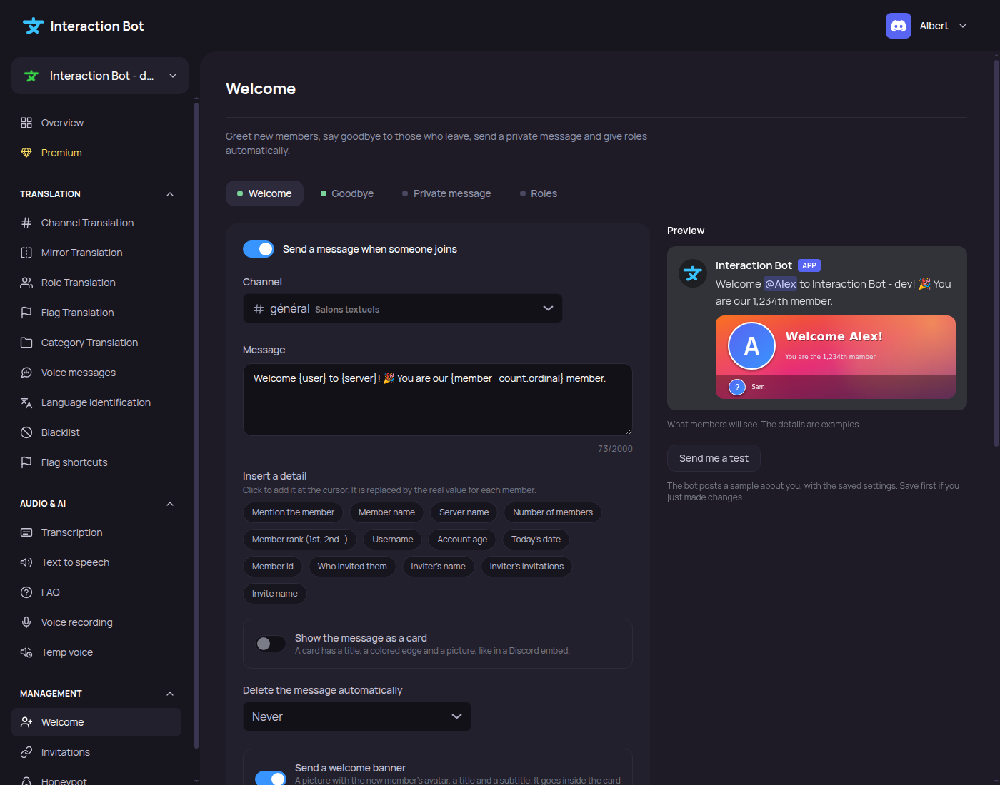

# Welcome

<figure><figcaption>
Welcome page
</figcaption></figure>

The Welcome page sets the messages the bot sends when a member joins or leaves the server, the private message to new members, the banners and the automatic roles. For how the feature works, the variables and the limits, see [Welcome and goodbye](../../management/welcome-and-goodbye.md).

Navbar > section _**Management**_ > _**Welcome**_.

## Quick start

On a server where the Welcome page has never been saved, and where no message is turned on, the page shows a single question:

| Field | Default | What it does |
| --- | --- | --- |
| **Channel for welcome messages** | Nothing chosen | The text channel where the welcome message is posted. |
| _**Turn on welcome messages**_ (button) | Disabled until a channel is chosen | Turns on the welcome message in this channel, with a default text. The goodbye and private message texts are also filled in, but these two messages stay off. |

After the quick start, the page shows the four tabs. Click _**Save**_ to keep the settings.

## Tabs

The page has four tabs. Each tab has a dot: green when the feature is on, grey when it is off. The tab _**Roles**_ is green when at least one role is chosen.

| Tab | Label | Turns on with |
| --- | --- | --- |
| Welcome | _**Welcome**_ | _Send a message when someone joins_ |
| Goodbye | _**Goodbye**_ | _Send a message when someone leaves_ |
| Private message | _**Private message**_ | _Send a private message to new members_ |
| Roles | _**Roles**_ | Roles chosen in the tab |

The first switch of each message tab turns the message on or off. While it is off, the rest of the tab is hidden, and the preview is hidden too.

### Welcome

The welcome message is posted in a channel when a member joins.

| Setting | Default | What it does |
| --- | --- | --- |
| **Send a message when someone joins** | Off | Turns the message on. When it is turned on with an empty text and no card, the text _Welcome {user} to {server}! 🎉 You are our {member_count.ordinal} member._ is written. |
| **Channel** | Nothing chosen | A text channel or an announcement channel. A channel is required when the message is on. |
| **Message** | Empty | The text of the message. Up to **2000** characters. Click a variable button (for example _**Mention the member**_) to insert it where the cursor is. |
| **Variables** | - | Buttons that insert `{user}`, `{user.display_name}`, `{server}`, `{member_count}`, `{member_count.ordinal}`, `{user.name}`, `{account_created}`, `{date}`, `{user.id}`, `{inviter}`, `{inviter.name}`, `{invites}` and `{invite_label}`. |
| **Show the message as a card** | Off | Shows the text as a card: see [Card](#card-of-a-message) below. |
| **Delete the message automatically** | Never | The welcome message is deleted after 10 seconds, 30 seconds, 1 minute, 5 minutes or 1 hour. _Never_ keeps it. This option is only on the Welcome tab. |
| **Send a welcome banner** | Off | Sends a banner with the message: see [Banner](#banner). |

### Goodbye

The goodbye message is posted in a channel when a member leaves. The member is named, not pinged.

| Setting | Default | What it does |
| --- | --- | --- |
| **Send a message when someone leaves** | Off | Turns the message on. When it is turned on with an empty text and no card, the text _{user.display_name} left the server. 👋_ is written. |
| **Channel** | Nothing chosen | A text channel or an announcement channel. A channel is required when the message is on. |
| **Message** | Empty | Up to **2000** characters. The variable buttons do not show `{user}`. Typing `{user}` still shows the name of the member. |
| **Show the message as a card** | Off | Same as the Welcome tab. |
| **Send a goodbye banner** | Off | Sends a banner with the message. Default texts: title _Goodbye {user.display_name}!_, subtitle _We are now {member_count} members_. |

There is no automatic deletion on the Goodbye tab.

### Private message

The private message is sent to the new member, in private messages. It needs no channel.

| Setting | Default | What it does |
| --- | --- | --- |
| **Send a private message to new members** | Off | Turns the private message on. Nothing happens if the member closed their private messages. When it is turned on with an empty text and no card, the text _Welcome to {server}, {user.display_name}! Take a look at the rules and enjoy your stay._ is written. |
| **Message** | Empty | Up to **2000** characters. |
| **Show the message as a card** | Off | Same as the Welcome tab. |
| **Send a banner with the private message** | Off | Sends a banner with the message. Default texts: title _Welcome to {server}!_, subtitle _Glad to have you with us_. |

There is no automatic deletion on the Private message tab.

### Card of a message

The card is shown when _**Show the message as a card**_ is on.

| Setting | Default | What it does |
| --- | --- | --- |
| **Title** | Empty | The title of the card. Up to **256** characters. |
| **Message** (text of the card) | Empty | The body of the card. Up to **4096** characters. |
| **Color** | `#3894FE` (blue) | The color of the edge of the card. Picked with the color picker. |
| **Show the member's avatar** | On | Shows the avatar of the member as a small picture. |
| **Picture of the card** | None | A large picture at the bottom of the card. Drop a picture in the area, or click it to choose one. The picture is removed with _**Remove**_. A card saved with an `https://` address keeps it, and can only be removed. |
| **Small text at the bottom** | Empty | The footer of the card. Up to **2048** characters. |

The page shows the recommended size of the picture: **1200 × 675 px** (16:9).

### Banner

The banner is a picture of **1000 × 350 px**, with the avatar of the member, a title and a subtitle. It is turned on with the _**Send a … banner**_ switch of each tab.

| Setting | Default | What it does |
| --- | --- | --- |
| **Show the banner inside the card** | On | Shown only when the message is a card. On: the banner is the picture of the card. Off: the banner is sent under the message, and the card can have its own picture. |
| **Classic layout** or **Custom layout** | Classic layout | Classic: the avatar, the title and the subtitle. Custom: the banner made in the banner editor. |
| **Design my own layout** (or **Edit the layout**) | - | Opens the banner editor. _**Back to the classic layout**_ removes the custom layout. |
| **Banner background** | _Aurora_ | One of the 8 designs: _Aurora_, _Sunset_, _Ocean_, _Forest_, _Midnight_, _Neon_, _Candy_ or _Slate_. Or one of your pictures, or a solid color (**Solid color**). |
| **Your picture** | Empty | Drop a PNG, JPEG or WebP picture (4 MB at most). Up to **10** pictures per server. Delete one with its trash button. |
| **Banner title** | Empty: _Welcome {user.display_name}!_ (goodbye and private message: see the tab) | The big text. Up to **120** characters. No emoji. |
| **Banner subtitle** | Empty: _You are the {member_count.ordinal} member_ | The smaller text under the title. Up to **120** characters. |

When a custom layout is saved, the title and subtitle are not used; the texts are written in the banner editor. The classic title and subtitle are kept if you go back to the classic layout.

Quick insertion buttons under the title and subtitle: _Member name_, _Server name_, _Member rank (1st, 2nd…)_, _Number of members_ and _Username_.

#### Banner editor

The editor opens with _**Design my own layout**_ and shows the banner at full size, the list of elements, the templates and the properties of the selected element.

| Part | What it does |
| --- | --- |
| _**Add an element**_ toolbar | _**Text**_, _**Avatar**_, _**Shape**_ or _**Picture**_. At most **20** elements, and **4** pictures. |
| **Templates** | _Classic_, _Centered_, _Minimal_, _Framed_ and _Invited by_. A template replaces the current layout. |
| **Layers** | The list of elements. The first one is at the back. _**Bring forward**_, _**Send backward**_, _**Duplicate**_ and _**Delete**_ act on the selected element. |
| **Real rendering** (_**Show the real rendering**_) | Asks the bot to draw the exact banner, about you. At most 30 times a minute. |
| **Done** | Keeps the layout on the page. It is saved with _**Save**_. |
| **Discard** | Asks _Discard your changes?_ with _**Discard**_ and _**Keep editing**_. |

Element properties:

| Element | Settings and defaults |
| --- | --- |
| **Text** | Text (variables allowed, up to 200 characters), font (_Sans_ by default, _Serif_, _Mono_), bold (Off), size (10 % of the banner height by default), color (`#FFFFFF`), alignment (_Left_ by default, _Center_, _Right_), vertical position (_Middle_ by default, _Top_, _Bottom_), shadow (On). |
| **Avatar** | Whose picture (_The new member_ by default, _Who invited them_, _The server icon_), shape (_Circle_ by default, _Rounded square_, _Square_), border width (6 by default, 0 to 20), border color (`#FFFFFF`), shadow (On). |
| **Shape** | Shape (_Rectangle_ by default, _Circle_), fill color (`#000000`), gradient with a second color (Off), opacity (35 % by default), rounded corners (Rectangle only), border width (0), border color (`#FFFFFF`). |
| **Picture** | One of your pictures, fit (_Fill the box_ by default, or _Show it all_), rounded corners, opacity (100 % by default), border width (0), border color (`#FFFFFF`). |

Every element has its position and size in percent of the banner: left, top, width and height. Use _**Center horizontally**_ and _**Center vertically**_ to center an element.

### Preview

The right side of each message tab shows the message as Discord will display it. The server name is the name of your server, the member name is the example _Alex_, and the member count is the example 1,234. The banner is drawn in the page, so it can be a little different from the real one. Use _**Show the real rendering**_ in the banner editor to see the exact picture.

### Automatic roles

The Roles tab sets the roles given automatically.

| Setting | Default | What it does |
| --- | --- | --- |
| **Roles for new members** | None | Roles given to every new member. At most **10**. |
| **Wait until the member accepts the rules** | On | When the server uses membership screening, the roles are given after the member accepts the rules. Off: the roles are given when the member joins. |
| **Roles for new bots** | None | Roles given to every new bot. At most **10**. |

You can only choose a role that you could give yourself (*Manage Roles*, below your highest role) and that has no moderation or administration permission. The bot also checks the role at each save (it must be below its own highest role). A warning appears when the bot cannot manage roles yet.

### Intent and permission warnings

| Message | Shown when | What to do |
| --- | --- | --- |
| _Not available on this bot yet_ | The bot does not have the Server Members intent. | Nothing to do on the page. The settings are saved. See [Server Members intent](../../management/welcome-and-goodbye.md#server-members-intent). |
| _The bot cannot manage roles yet: give it the permission to manage roles, and put its role above the ones you choose._ | Roles are chosen, and the bot lacks *Manage Roles*. | Give the bot *Manage Roles*, and move its role above the chosen roles. |

## Test

The _**Send me a test**_ button is under the preview of each message tab.

| Element | Default | What it does |
| --- | --- | --- |
| **Send me a test** | Disabled while there are unsaved changes | Makes the bot post a sample about you (the welcome or goodbye message in its channel, or the private message to you). |
| Help text | _The bot posts a sample about you, with the saved settings. Save first if you just made changes._ | Shown when no test was sent yet. |
| Result | - | _Test sent._ for a channel message, _Check your private messages._ for the private message. Otherwise the reason (see [Test a message](../../management/welcome-and-goodbye.md#test-a-message)). |

A test welcome or goodbye message is deleted after 2 minutes at most.

## Save

Any change makes a bar appear at the bottom of the page: _You made changes, save them!_, with _**Cancel**_ and _**Save**_.

| Button | What it does |
| --- | --- |
| _**Save**_ | Saves all the tabs at once. The bot uses the new settings right away. |
| _**Cancel**_ | Restores the last saved settings. |

When the save fails, the page shows the reason of the error:

| Message | Cause |
| --- | --- |
| _Choose a text channel of this server._ | The channel was deleted, or it is not a text or announcement channel. |
| _Choose a channel for each message you turn on._ | A message is on, and no channel is chosen (welcome or goodbye). |
| _One of the roles no longer exists._ | A chosen role was deleted. |
| _You can only choose a role you could give yourself (Manage Roles, below your highest role), without moderation or administration permissions._ | The role is not allowed (see [Automatic roles](#automatic-roles)). |
| _The picture chosen for the card no longer exists: choose another background._ | The background picture was deleted. |
| _The picture of the card no longer exists. Choose another one._ | The picture of the card was deleted. |
| _The bot does not answer right now. Try again in a moment._ | The bot is not reachable. Try again. |
| _The settings could not be saved. Try again._ | Any other error. |

## Limits

| Item | Limit |
| --- | --- |
| Message text | 2000 characters |
| Card title | 256 characters |
| Card text | 4096 characters |
| Card footer | 2048 characters |
| Banner title and subtitle | 120 characters each |
| Text in a custom banner | 200 characters |
| Elements in a custom banner | 20 |
| Pictures in a custom banner | 4 |
| Pictures per server | 10 (20 MB in total) |
| Size of a picture sent | 4 MB, PNG, JPEG or WebP |
| Roles for new members, roles for new bots | 10 each |

The page is free for every server.

## Related pages

* [Welcome and goodbye](../../management/welcome-and-goodbye.md): how the feature works, the variables, the permissions and the troubleshooting.
* [Permissions](../../permissions.md): the permissions of each feature.
