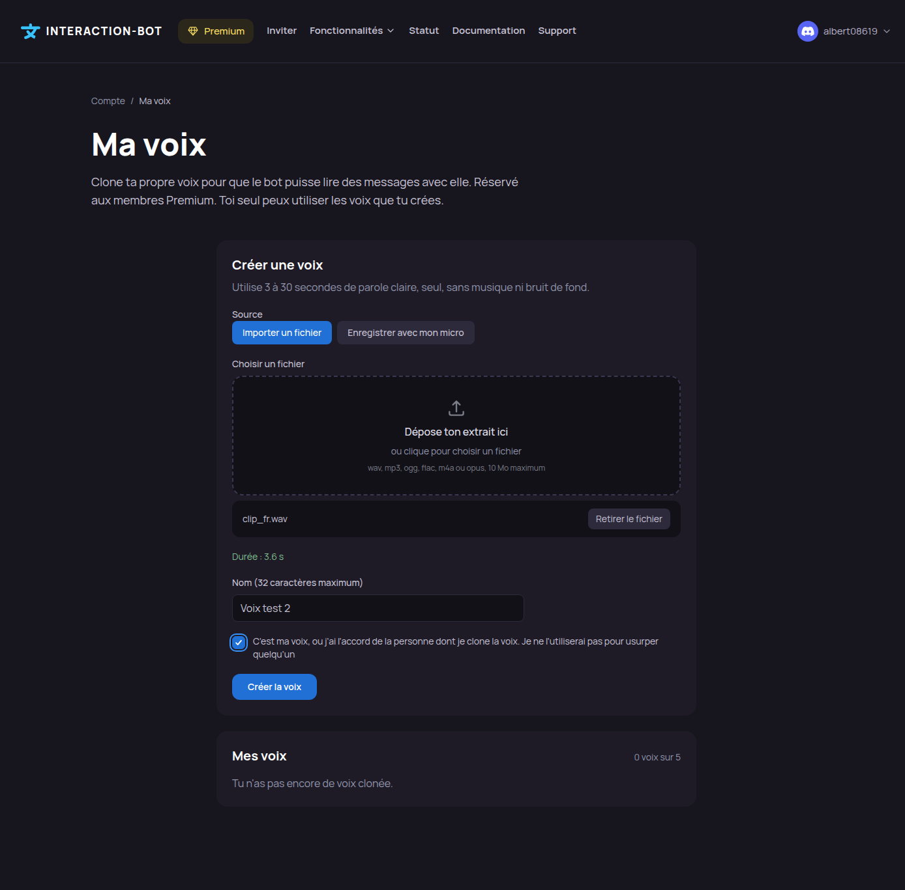
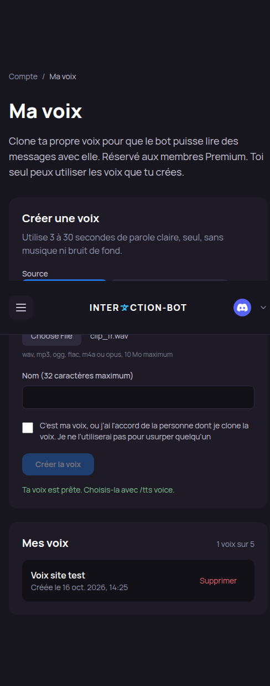

# My voice

The **My voice** page (`interaction-bot.com/my-voice`) lets you create and manage your **cloned voices**: voices made from a short recording of your own voice, which the bot can use to read messages. Only you can use the voices you create. The page is for **Premium** members; the voices you already have can always be listed and deleted.

Creating a voice is a Premium feature: see [Who can create and use a cloned voice](../audio/voices-and-cloning.md#who-can-create-and-use-a-cloned-voice). The same voices are used on Discord, with [`/tts voice`](../audio/voices-and-cloning.md#choose-your-voice-tts-voice).

## Open the page

1. Log in to the website, then open the user menu and the **Account** page.
2. In the section **My voices**, click **Manage my voices**.

You can also open `interaction-bot.com/my-voice` directly. The page needs you to be logged in.

<figure><figcaption>
The My voice page
</figcaption></figure>

## Create a voice

If you are not premium, the page shows an invitation to see Premium instead of the form. Your existing voices stay in the list below it.

If you are premium, the form has these fields:

1. **Source**: **Import a file** or **Record with my microphone**.
2. **The recording**:
   * *Import a file*: drop a file on the zone or click it to choose one. Accepted formats: wav, mp3, ogg, flac, m4a or opus, 10 MB maximum.
   * *Record with my microphone*: click **Start recording**, speak, then click **Stop recording**. The counter shows the time (for example *12 / 30 s*). The recording stops by itself at 30 seconds. Your browser asks for access to the microphone the first time.
3. **Duration**: the page reads the duration of the clip and shows it (*Duration: 3.6 s*). The clip must last **3 to 30 seconds**.
4. **Name**: 32 characters at most. A name cannot contain a link, a mention or a control character.
5. **Consent**: tick the box. It says that the voice is yours, or that you have the agreement of the person whose voice you clone, and that you will not use it to impersonate anyone. The voice cannot be created without it.
6. Click **Create the voice**.

The page checks the clip and the name before sending anything, and the server checks them again. The clip is sent to the speech service and is **not kept**: it is not stored in your browser or on the server.

When the voice is ready, the page shows *Your voice is ready. Choose it with /tts voice.* The voice is then in your list.


Wait **30 seconds between two attempts**. An attempt counts once it has passed the premium, consent and limit checks, even when the clip is then refused. Only one voice can be created at a time.


## My voices

The list shows, for each voice, its name and its creation date, and the count of voices used, for example *1 of 5 voices*. The limit is **5 voices** per member.

To delete a voice, click **Delete**, then **Yes, delete**. The voice is removed at once and **cannot be restored**. On Discord, a member who had chosen it gets an automatic voice again.

<figure><figcaption>
The My voice page on a phone
</figcaption></figure>

## Messages

| Message | Meaning |
| --- | --- |
| *Creating a voice is a Premium feature.* | Your account is not premium, and the server rule is not met. See [Premium](../premium/premium.md). |
| *Tick the consent box to create a voice.* | The consent is required. |
| *You already have 5 voices. Delete one to create another.* | The limit of 5 voices is reached. |
| *A voice is already being created. Wait for it to finish.* | Another creation is in progress. |
| *Wait 30 seconds between two attempts.* | Wait, then try again. |
| *The voice service refused this clip. Try a clearer one, without music.* | The speech service did not accept the recording. |
| *The voice service is unavailable right now. Try again later.* | The speech service does not answer. Try again later. |
| *The clip does not meet the rules: 3 to 30 seconds, a supported format, 10 MB maximum.* | Check the recording against the rules. |
| *This file cannot be read as audio.* | The file is not a readable audio file. |
| *The name must be 1 to 32 characters, without link, mention or control character.* | Change the name. |
| *The microphone is not available. Allow it in your browser, or import a file.* | Allow the microphone in your browser settings, or import a file instead. |
| *The voice could not be deleted. Try again.* | The speech service did not answer. Try again. |

## Privacy

* The recording is sent to the speech service to create the voice, then dropped. It is not kept by the website or by the bot.
* The page shows only your own voices.
* The [Privacy card](dashboard/account.md#privacy) of the Account page counts your cloned voices, lets you download their metadata, and deletes them with **Delete my data** or **Delete my account**.

## Related

* [Voices and cloning](../audio/voices-and-cloning.md): the rules, the commands and the limits.
* [Account](dashboard/account.md): the other personal settings.
* [Premium](../premium/premium.md): what Premium gives.
