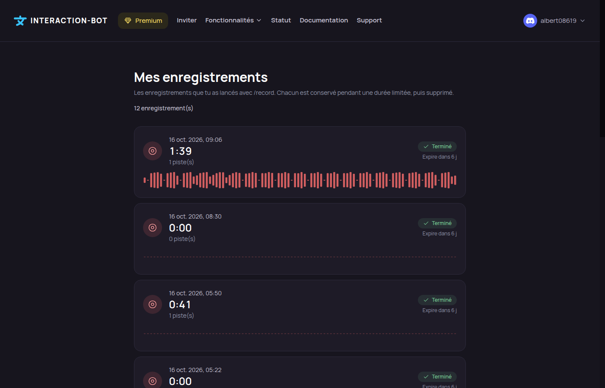
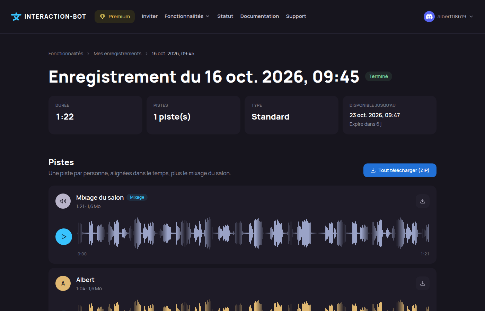

# My recordings

My recordings is the page of the website where the member who started a [voice recording](../audio/recording.md) listens to it, downloads it, exports it as a video and transcribes it.

<figure><figcaption>
My recordings page
</figcaption></figure>

## Localization

* The list is at **/recordings**. Open it from the **My recordings** button of the Account page, from the link in the recording panel, or from the **Download** button of the private message sent when a recording is ready.
* Each recording has its own page, at **/recordings/** followed by its identifier.
* You must be signed in with Discord.

## Who can see a recording

Only the member who **started** the recording can open it. The list shows the recordings you started, on any server. Another member, even one who was in the channel, gets the message *This recording does not exist or is not yours.*

There is no link to share a recording: a recording page cannot be opened by anyone else.

## The list

The list shows your last 100 recordings, newest first. Each card gives:

* the date and the time it started;
* the duration;
* the status: *Finished*, *In progress*, *Interrupted*, *Failed* or *Expired*;
* the number of tracks (one per speaker, the mix not counted) and a waveform of the mix;
* when the files will be deleted (*Expires in 6 d*). The time turns amber when less than 24 hours are left.

## A recording

<figure><figcaption>
Page of a recording, with the mix and the tracks
</figcaption></figure>

The page of a recording shows the date, the status, and four boxes: **Duration**, **Tracks**, **Type** (*Standard* or *Continuous*) and **Available until**.

Notices explain what you can expect from the files:

| Status | Notice |
| --- | --- |
| In progress | The files will be available once the recording is stopped. |
| Interrupted | The bot restarted or stopped before the end. The audio was recovered up to that moment. |
| Failed | The recording could not be completed, so no file is available. |
| Expired | The files were deleted at the end of the retention period. |

### Listening

The **mix** (*All voices*) comes first, then one track per speaker, each with its waveform.

* Press the round **play** button to listen. Only one track plays at a time: starting another one pauses the first.
* Click or drag on a waveform to move to that point.
* The player listens to the track as it is stored, so it can be moved within. Changing the download format does not change the player.

### Notes

If notes were added during the recording (with `/record note` or the panel), they are listed under **Notes**, with their time and author. A click on a note jumps to its moment in the mix.

### Downloads

* Each track and the mix have a **download** button. The file is named after the recording and the speaker.
* **Download all (ZIP)** gets every track and the mix in one ZIP file, with `notes.txt` (the notes with their time) and `labels.txt` (labels for Audacity: *File > Import > Labels*). It appears when the recording has more than one track.
* Choose the **format** above the tracks: FLAC (the default of the server), M4A, MP3, OGG or WAV. OGG is the stored file, without a new encoding. The other formats are made from it, so their quality is that of the stored file. See [Downloads and export](../audio/recording.md#downloads-and-export).

### Video export

**Export as video** makes an MP4 that reproduces the call: a tile per person, a border around the person speaking, and the audio of the mix. Choose the layout (*Call grid* or *Vertical list*), the theme (dark or light), the resolution (720p or 1080p), whether names are shown, and the border colour. The starting values are the defaults of the server (see the [dashboard](dashboard/voice-recording.md)).

* The mix must be 2 hours or less.
* Only one export runs per server at a time: a second one is refused until the first has ended.
* When the export is ready, the video plays on the page and can be downloaded as an MP4 file.

### Transcription

The **Transcript** section turns the recording into text: each passage comes with its time and its speaker. The bot starts it, then works for a while: you can close the page and come back.

* Click **Transcribe** to start. The progress is shown while it runs, and **Cancel** stops it.
* The text is shown when it is ready, and exported as **TXT**, **SRT**, **VTT** or **JSON**.
* The bot also sends you a private message when the transcription is ready, or when it has failed.
* The transcription is not possible while the recording is in progress, after it expired, or when the server turned it off.
* The limits (one transcription every 30 days on a free server, one every 24 hours with Premium) are explained in [Transcription of a recording](../audio/recording.md#transcription-of-a-recording).

Messages you can see:

| Message | Meaning |
| --- | --- |
| *Transcription is turned off on this server.* | The server does not allow transcriptions of its recordings. |
| *A transcription of this recording is already running.* | Wait for it, or cancel it. |
| *You have reached today's limit.* / *One transcription per month on a free server, one per day with Premium.* | The limit of your account is reached. The page says when it starts again. |
| *This recording is too long to be transcribed.* | A track is longer than 4 hours. |
| *No speech was found in this recording.* | The transcription is complete, and nothing was heard in the recording. |
| *The transcription could not be started. Try again.* | Any other error. Try again later. |

## Privacy

* The files are **stored encrypted**. They are decrypted only to let you listen to, download, export or transcribe them.
* The download and listening links are not cached by the browser.
* A recording is **deleted automatically** after its retention: **24 hours** on a free server, **7 days** with Premium. The retention is set when the recording starts. Its page then shows *Expired*, and its transcription is deleted with it.
* There is no button to delete one recording. To delete everything the bot holds about you, including the recordings you started, use **Delete my data** on the Account page, in the **Privacy** section (see [Security and privacy](../security.md)). Your voice is also removed from the recordings where you speak. Recordings you started are deleted entirely, with the voices of everyone in them.
* To stop being recorded, use the **Do not record me (opt-out)** switch in the same section. See [Opt-out](../audio/recording.md#opt-out).

## Related

* [Voice recording](../audio/recording.md): the `/record` command, the rules and the limits.
* [Voice recording on the dashboard](dashboard/voice-recording.md): the settings of your server.
* [Premium](../premium/premium.md): longer retention and higher limits.
