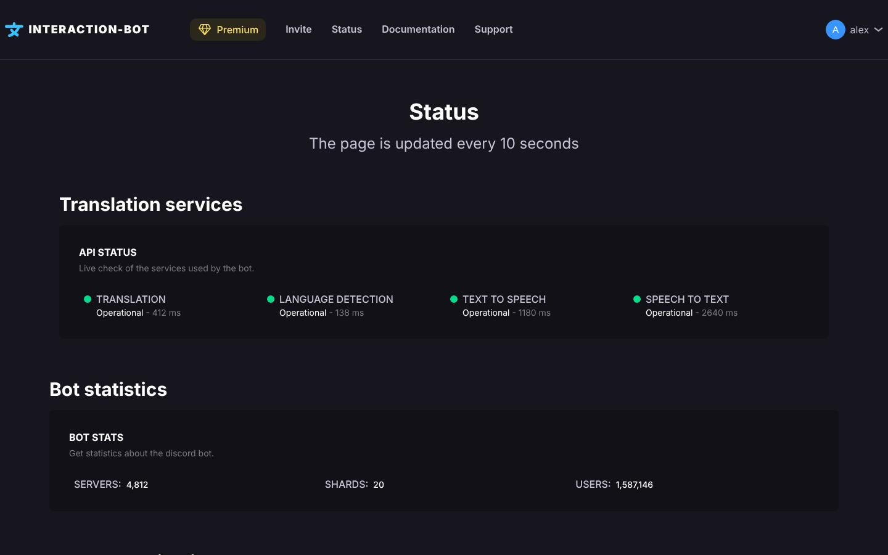

# Status

## Localization

The status page is on the website of the bot. You can access it with the link below. It does not need a login, and it is refreshed every 10 seconds.



## Translation services

This section shows the state of the services used by the bot to translate, detect languages, read text (text to speech) and transcribe voice (speech to text). It is a live check: the page runs a small test request for each service.

Each service shows a colored dot, its name, its state and, when the service answered, its response time in milliseconds (for example `Operational - 420 ms`).

| Name | Meaning |
| --- | --- |
| **Translation** | Translates the messages. |
| **Language detection** | Detects the language of the messages. |
| **Text to speech** | Reads text in a voice channel. |
| **Speech to text** | Transcribes the voice of a voice channel. |

The states are:

* <mark style="color:green;">Operational</mark>: the service answers, and the response time is under the limit of the service (1.5 s for language detection, 4 s for translation, 8 s for text to speech and 15 s for speech to text).
* <mark style="color:yellow;">Degraded</mark>: the service answers too slowly, or it is busy (it refuses some requests for now). Translations can take longer than usual.
* <mark style="color:red;">Outage</mark>: the service does not answer, or returns a server error. The bot cannot use it.
* <mark style="color:gray;">Unknown</mark>: the test request was refused, so the state cannot be known for sure, or the service is not configured.
* <mark style="color:gray;">Checking...</mark>: the first check of the service has not finished yet. The page asks again in a few seconds.

The results are kept for up to 30 seconds, so a change can take a short time to appear.

<figure><figcaption>
Status page
</figcaption></figure>

## Bot statistics

The **Bot stats** section shows:

* **Servers**: the number of servers where the bot is.
* **Shards**: the total number of shards of the bot. A shard is a connection to Discord that carries a part of the servers.
* **USERS**: the sum of the member counts of all the servers. A member who is in several servers is counted in each of them, so this is not the number of different people.

## Server localization

Use this section to find where your server runs: enter the **ID** of your server in the **Server ID** field (you can find it in the [Overview](dashboard/overview.md) page of the dashboard), then click on _**Calculate**_.

<figure><figcaption></figcaption></figure>

The result says *The guild is located on Cluster N and on the shard M.* The result is calculated from the ID only: it does not check that the bot is on this server.

## Cluster Status

A **cluster** is a group of shards that runs on one process. A cluster runs up to 10 shards, and the servers of a cluster are only available when this cluster works. The title shows the figures of the bot:

* *X / Y shards*: the number of shards that are working, out of the total.
* *X / Y clusters*: the number of clusters that are working, out of the total.

Each cluster is a square with its number. Its color shows its state:

* <mark style="color:green;">Operational</mark> (green): the cluster answers, and its ping is under 150 ms.
* <mark style="color:yellow;">Partial Outage</mark> (yellow): the cluster answers, but its ping is above 150 ms. The bot is slower for the servers of this cluster.
* <mark style="color:red;">Major Outage</mark> (red): the cluster does not answer.

<figure><figcaption>
Cluster Status
</figcaption></figure>

Place your cursor on a cluster (or tap it on a phone) to see its details:

* the range of shards that it runs;
* its number of servers and members;
* its ping, in milliseconds.

For a red cluster, only the estimated range of shards is shown.

To know the cluster of your server, see [Server localization](#server-localization), or the **CLUSTER** field of the [Overview](dashboard/overview.md) page of the dashboard.
