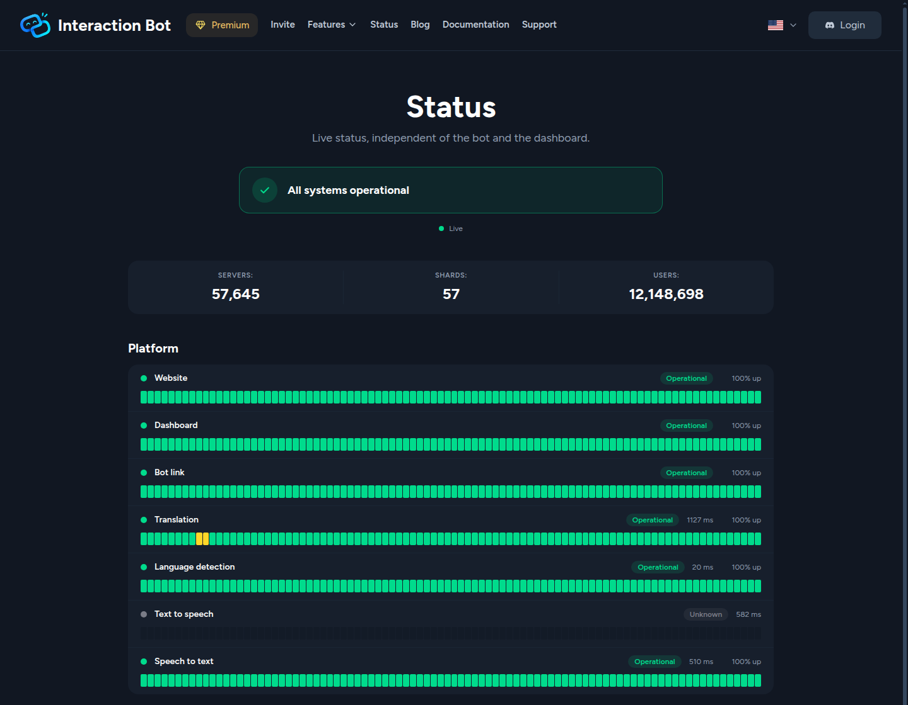
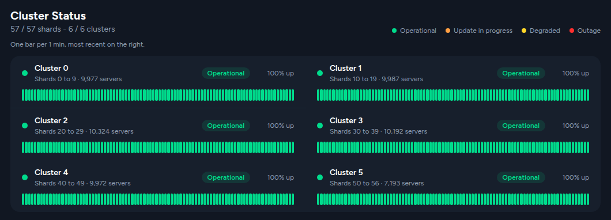

# Status

## Access

The status page is on the website of the bot, at `interaction-bot.com/status`. It does not need a login. It is updated live; if the live connection fails, it refreshes every 5 seconds. If the status source itself cannot be reached, the page says so, and nothing on it is confirmed until the next update.

<figure><figcaption>
The Status page
</figcaption></figure>



## Overall state

A banner at the top gives the state of the whole service: **All systems operational**, **Update in progress**, **Some systems have issues** or **Major outage**.

## Platform and API status

The **Platform** section lists the parts of the website: the **Website**, the **Dashboard** and the **Bot link** (the connection between the website and the bot). The **API status** section lists the translation services used by the bot:

| Name | Meaning |
| --- | --- |
| **Translation** | Translates the messages. |
| **Language detection** | Detects the language of the messages. |
| **Text to speech** | Reads text in a voice channel. |
| **Speech to text** | Transcribes the voice of a voice channel. |

Each line shows a colored dot, its state, the response time when the service answered (for example `Operational - 420 ms`), its **history** and its uptime percentage.

The service checks run in the background about every minute, whether or not the page is open, so a change can take up to a minute to appear.

The states are:

* <mark style="color:green;">Operational</mark>: the service answers, and the response time is under the limit of the service. The limits are 1.5 s for language detection, 4 s for translation, 8 s for text to speech and 15 s for speech to text.
* <mark style="color:yellow;">Degraded</mark>: the service answers too slowly, or it is busy and refuses some requests for now. Translations can take longer than usual.
* <mark style="color:red;">Outage</mark>: the service does not answer, or returns a server error. The bot cannot use it.
* <mark style="color:gray;">Unknown</mark>: the state cannot be known for sure yet, for example until the first check has finished.

## Bot statistics

The **Bot statistics** section shows:

* **Servers**: the number of servers where the bot is.
* **Shards**: the number of shards of the bot. A shard is a connection to Discord that carries a part of the servers.
* **Users**: the sum of the member counts of all the servers. A member who is in several servers is counted in each of them, so this is not the number of different people.

## Server localization

Use this section to find where your server runs: enter the **ID** of your server in the **Server ID** field (you can find it in the [Overview](dashboard/overview.md) page of the dashboard), then click on _**Calculate**_.

The result says *The guild is located on Cluster N and on the shard M.* The result is calculated from the ID only: it does not check that the bot is on this server.

## Cluster status

A **cluster** is a group of shards that runs on one process. The servers of a cluster are only available when this cluster works. The title shows the figures of the bot:

* *X / Y shards*: the number of shards that are working, out of the total;
* *X / Y clusters*: the number of clusters that are working, out of the total.

Each cluster is a square with its number. Its color shows its state:

* <mark style="color:green;">Operational</mark> (green): the cluster answers, and its ping is 150 ms or less.
* <mark style="color:yellow;">Degraded</mark> (yellow): the cluster answers, but its ping is above 150 ms. The bot is slower for the servers of this cluster.
* <mark style="color:red;">Outage</mark> (red): the cluster does not answer.
* **Update in progress** (orange) and **Restarting** (orange-red): the cluster is being updated or restarted, and its last known figures are shown. The clusters are restarted one after the other, once a day, so a short restart of one cluster is normal.

<figure><figcaption>
The clusters of the bot
</figcaption></figure>

Place your cursor on a cluster (or tap it on a phone) to see its details:

* the range of shards that it runs;
* its number of servers and members;
* its ping, in milliseconds.

For a red cluster, the range of shards and the last known figures are shown.

To know the cluster of your server, see [Server localization](#server-localization).

## Recent changes

The **Last 7 days** section lists every change of state of the platform and of the clusters over the last 7 days, with its duration. Each line of history is a bar: a green bar is a period where everything worked, and the uptime percentage sums it up.
